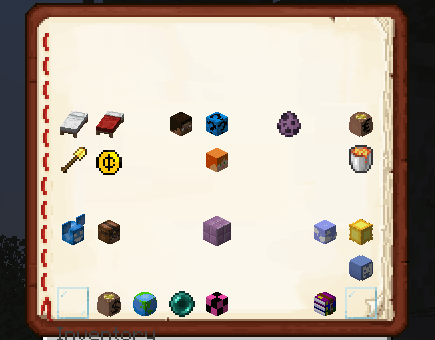
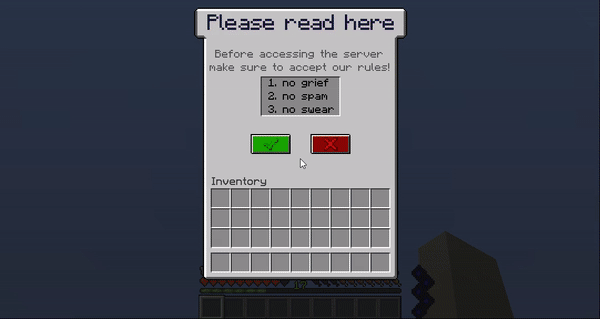
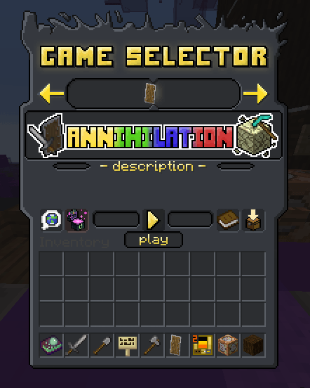

# GUIs

为了制作GUI，你可以复制并粘贴我的名为`_iainternal`的包，并根据你的喜好进行编辑：\
`contents/_iainternal/resourcepack/assets/_iainternal/textures/gui/`

要创建自定义 GUI，可以使用 [JavaAPI](https://wiki.itemsadder.com/developers/java-api/huds-guis-images-and-more)，或安装 [ChestCommands](https://dev.bukkit.org/projects/chest-commands) 等插件。\
如果你使用像ChestCommands这样的插件，你必须将GUI命名为:

```
:offset_-16::blank_menu:
```

这告诉ItemsAdder用一个`-16`偏移特殊字符替换GUI名称，该字符将`blank_menu`纹理向后移动16个像素。



## 示例附加包

可在这里获取附属示例\
[https://www.spigotmc.org/resources/gui-server-rules-main-menu-itemsadder-addon.84793/](https://www.spigotmc.org/resources/gui-server-rules-main-menu-itemsadder-addon.84793/)



## 用户创建的示例内容（版权归Gust所有）



**我不是这个资源的所有者**

