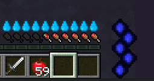

# HUDs

ItemsAdder 提供 2 个自定义 HUD 示例，涵盖全部可用功能。

这两个 HUD 分别是魔力条和口渴条。\
你可以在**realcraft**和**magiccraft**命名空间中找到它们。



## 在世界中禁用/启用 HUDs

你可以轻松地在某些世界中禁用/启用 HUDs，以下是一些示例：

### 在所有世界中启用

要在所有世界中启用它们，只需避免在列表中输入任何世界，不要写入该属性。

```yaml
huds:
  thirst_bar:
    enabled: true
```

### 在所有世界中启用，但不在 `world_the_end` 中启用

```yaml
huds:
  thirst_bar:
    enabled: true
    worlds:
    - "!world_the_end"
```

注意世界名称前面的 `!`。（必须使用 `" "` 字符，否则插件不会正常工作，这是 `.yml` 的问题。）

### 在名称以 `world_` 或 `adventure` 开头的所有世界中启用

```yaml
huds:
  thirst_bar:
    enabled: true
    worlds:
    - "world_*"
    - "adventure*"
```

注意末尾的`*`，这意味着“_**任何**_”。 (请记住，这仅在名称末尾有效)

## 特殊设置（仅限专业用户）

在`config.yml`中有一个与 HUDs 相关的特殊设置。\
此设置允许你将所有 HUDs 重新着色为特定颜色。\
如果你有一个与具有特定颜色的文本交互的自定义着色器，这将非常有用。

需要 Minecraft 1.17+

```yaml
huds:
  enabled: true
  force_color:
    enabled: true
    color: '#FFFFFF'
```

更多信息[在这里](https://github.com/PluginBugs/Issues-ItemsAdder/issues/2931)。\
颜色选择器[在这里](https://g.co/kgs/Pvq3jj)。
