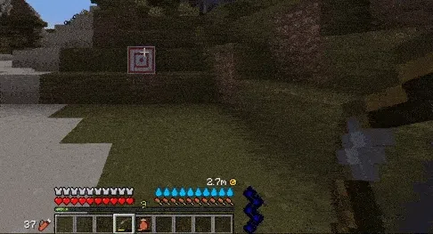
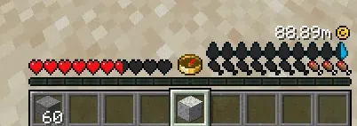

# 自定义 HUD（高级）

## 什么是自定义 HUD？

自定义 HUD 是一个设置了 `type: CUSTOM` 的 HUD。

这种特殊类型让你完全控制 HUD 的工作方式。在 YML 文件中没有指定图像，你可以避免创建 `player_stat_name`。

警告：

此 HUD 类型需要使用 [Java API](https://wiki.itemsadder.com/developers/java-api)，并具备 Java 编程知识。

[huds-guis-images-and-more.md](https://wiki.itemsadder.com/developers/java-api/huds-guis-images-and-more)

## 示例

