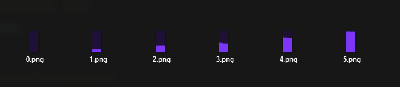
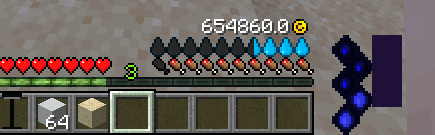
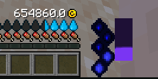

# 帧式 HUD

## 如何创建你的第一个 HUD（类型：FRAMES）

FRAMES HUD 允许你创建这样的 HUD：每个可能的数值都对应一种不同的纹理。

### 创建配置文件

第一步是在你的**命名空间**文件夹中创建一个配置文件。在这个例子中，我将创建一个名为`hud.yml`的文件。

```yaml
info:
  namespace: myitems
huds:
  example_hud:
    enabled: true
    show:
      auto: true
      creative: true
    type: FRAMES
    x_position_pixels: 120
    value:
      player_stat_name: example_stat
      start: 0
      min: 0
      max: 5
    images:
      frames:
      - myitems:example_hud_0
      - myitems:example_hud_1
      - myitems:example_hud_2
      - myitems:example_hud_3
      - myitems:example_hud_4
      - myitems:example_hud_5
```

正如你所看到的，我创建了一个配置文件，其中包含一些新 HUD 的设置。

`type: FRAMES` 用于创建一个 HUD，每个可能的值都有不同的纹理。

`x_position_pixels: 120` 用于使 HUD 在屏幕中心右侧 120 像素处定位。

`value` 属性用于决定 HUD 可以有多少个值，在这个例子中是从 0 到 5，起始值是 0。

`player_stat_name` 将 HUD 绑定到一个自定义玩家属性，该属性会在服务器重启后保留 HUD 的数值。这是自定义属性，并非原版属性，你可以自行命名。

`images frames` 为 [font_images](../../font-images.md) 纹理列表，HUD 的每个可用数值各对应一张。

重要提示：确保你的 HUD 的每个可能值都有一个有效的纹理。在这个例子中，值是从 0 到 5，所以我有 6 个图像，每个 HUD 值一个。

### 创建图像

创建一个新的 yml 文件，并在其中添加此代码，用于让 ItemsAdder 知道你的 HUD 图像的位置以及如何在屏幕上显示它们。

正如你所看到的，它们的名称与之前在 `hud.yml` 文件中声明的名称相同。

```yaml
info:
  namespace: myitems
font_images:
  example_hud_0:
    suggest_in_command: false
    path: example_hud/0.png
    y_position: -15
  example_hud_1:
    suggest_in_command: false
    path: example_hud/1.png
    y_position: -15
  example_hud_2:
    suggest_in_command: false
    path: example_hud/2.png
    y_position: -15
  example_hud_3:
    suggest_in_command: false
    path: example_hud/3.png
    y_position: -15
  example_hud_4:
    suggest_in_command: false
    path: example_hud/4.png
    y_position: -15
  example_hud_5:
    suggest_in_command: false
    path: example_hud/5.png
    y_position: -15
```

现在你需要为我们在前一个文件中指定的每个图像创建一个图像文件。

在此路径中创建它们（如配置中所设置的）`contents\myitems\resourcepack\myitems\textures\example_hud\`



完成！

### 查看 HUD 的效果

执行 `/iazip` 后即可在游戏中看到新 HUD（必要时还需按[托管教程](../../../../plugin-usage/plugin-configuration/resourcepack-hosting.md)操作）。



现在尝试编写此命令（将 `LoneDev` 更改为你的玩家名称）以更改 HUD 值：`/iaplayerstat write LoneDev example_stat float 2`



正如你所看到的，HUD 值已更改为 2！非常好！

### 使 HUD 值随时间自动变化

要让 HUD 随时间自动增长，可以使用[触发器](../trigger-value-change.md)。

### 使 HUD 值变化

要使 HUD 值变化，你可以在任何地方使用前面的 `write` 命令，在物品事件中，在其他插件中，随处可用。

## 使用 PAPI 占位符读取 HUD 值

`%iaplayerstat_myhud%`