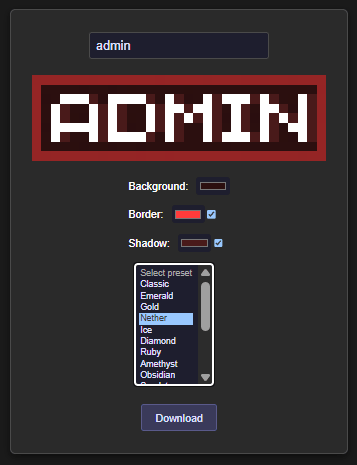
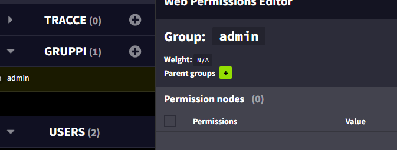
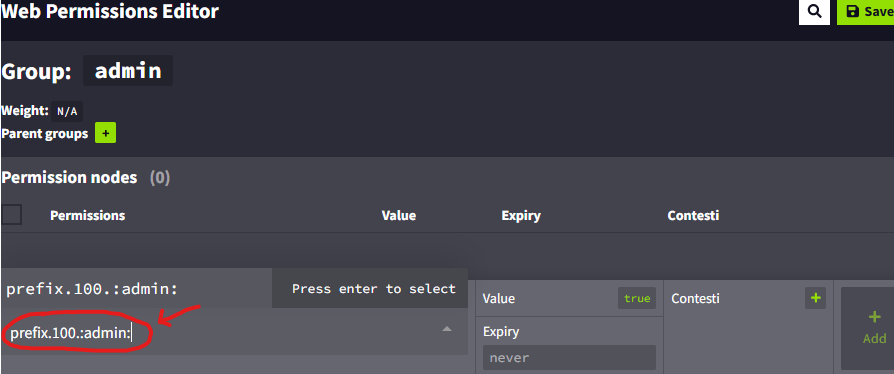
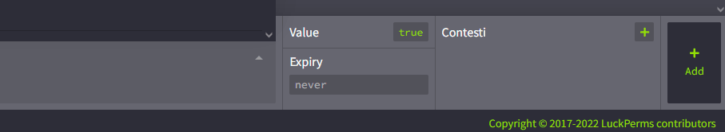
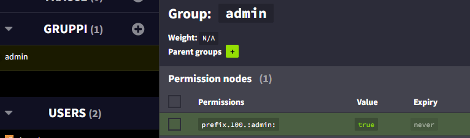
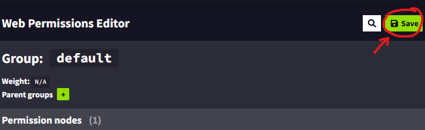

# 称号与前缀

**本教程需要使用** [**LuckPerms**](https://www.spigotmc.org/resources/luckperms.28140/) **和** [**TAB**](https://www.spigotmc.org/resources/tab-1-5-1-21-4.57806/)。使用其他权限或 TAB 插件时，方法可能不同。


从[这里](https://www.spigotmc.org/resources/ranks-betterranks-with-custom-textures-for-itemsadder.84852/)下载称号示例。

## 创建称号

创建新文件 `contents/myranks/config.yml`。

```yaml
font_images:  
  admin:
    permission: "ranks"
    show_in_gui: true
    suggest_in_command: false
    path: "font/admin.png"
    scale_ratio: 9
    y_position: 8
```

不要更改 PNG 图片高度（保持 8px），也不要更改 `scale_ratio` 和 `y_position`。\
否则称号图片会出现明显像素感。

### 创建自定义称号的官方工具


<figure><figcaption><p><a href="https://itemsadder.github.io/minecraft-rank-generator/">https://itemsadder.github.io/minecraft-rank-generator/</a></p></figcaption></figure>

将图片放入 `contents/myranks/textures/font/admin.png`。

#### 创建权限组（例如 `admin`）

命令 `/lp creategroup admin`

#### 添加前缀

打开编辑器 `/lp editor`。

点击链接，打开网页编辑器。\
选择权限组，本例为 `admin`。



添加新权限：`prefix.100.:admin:`。根据称号名称更改 `:admin:`。



点击 <mark style="color:green;">**`+Add`**</mark>



权限列表中会新增一行，这就是前缀设置。



保存更改。



#### 将权限组分配给玩家

使用此命令（将 `LoneDev` 改为你的玩家名称）：`/lp user LoneDev group add admin`


## TAB 插件

确认已安装 [PlaceholderAPI](https://modrinth.com/plugin/placeholderapi)

#### 编辑 TAB 插件的 config.yml

**在** `groups` 类别下添加此内容或编辑它（如果已存在）。\
（你必须使用 `%img_admin%` 而不是 `:admin:`，因为 **TAB** 只识别 **PlaceholderAPI** 占位符，而不识别 **ItemsAdder** 占位符。这也适用于**其他插件**）

```yaml
  Admin:
    tabprefix: '%img_admin%  '
    tagprefix: '%img_admin%  '
```

然后使用命令 `/tab reload`


