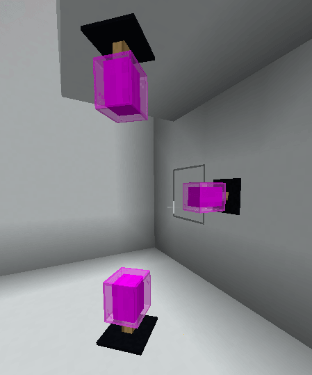
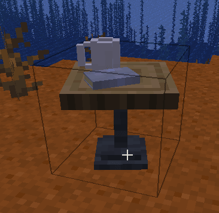
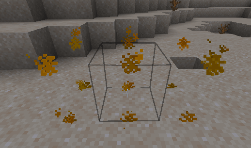
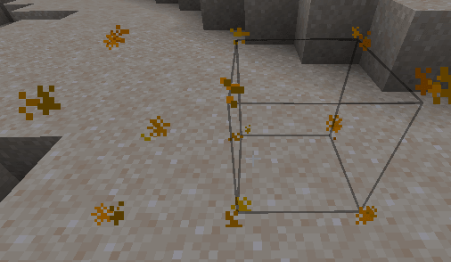
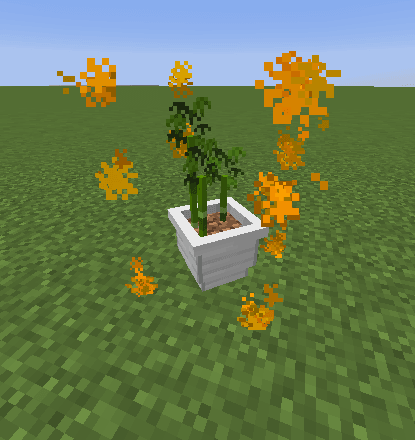
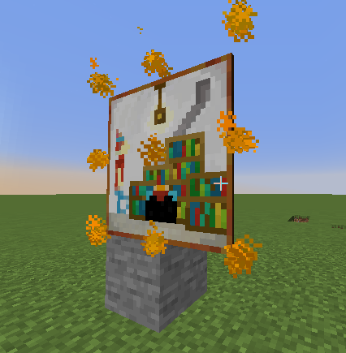

# 家具

家具是一种装饰物品，可以是实心的、发光的、用作椅子的，并且可以具有其他功能。

**所有家具的限制**

* 非实心家具无法接收交互事件，只能用鼠标左键移除，无法与之交互；只有实心家具可以接收交互事件。\
  较新的游戏版本可能已不再受此限制。
* 出于性能考虑，碰撞箱尺寸最大为 3x3x3。

## 家具实体类型

### `item_display`

此家具实体类型适合制作任意类型的家具。

```yaml
behaviours:
  furniture:
    entity: item_display # <---
    display_transformation:
      transform: HEAD
      right_rotation:
        axis_angle:
          angle: 180
          axis:
            x: 0
            y: 1
            z: 0
      translation:
        x: 0
        y: 0.92
        z: 0
      scale:
        x: 0.45
        y: 0.45
        z: 0.45
```

#### 特殊属性

`item_display` 允许通过 `display_transformation` 属性进一步调整家具模型。\
可以自由调整其大小、旋转和位置。\
此功能使用 **Minecraft** 原生的 `item_display` 功能，可在[这里](https://www.youtube.com/watch?v=bwPWfUbcZxE)及网上查阅更多信息。\
也可以使用[此工具](https://misode.github.io/transformation/)预览调整结果。

<details>

<summary>示例</summary>

```yaml
  lava_lamp_new:
    enabled: true
    display_name: display-name-lava_lamp
    permission: iadeco.decorations.lava_lamp
    lore:
      - lore-decorative-item
    resource:
      material: PAPER
      generate: false
      model_path: lava_lamp
    behaviours:
      furniture:
        entity: item_display # <---
        light_level: 7
        display_transformation:
          transform: HEAD
          right_rotation:
            axis_angle:
              angle: 180
              axis:
                x: 0
                y: 1
                z: 0
          translation:
            x: 0
            y: 0.92
            z: 0
          scale:
            x: 0.45
            y: 0.45
            z: 0.45
```

</details>

`auto_update_in_world`：自动将配置更改应用到世界中已放置的实体。默认值位于 `config.yml` 中的 `auto_update_transformations`，可用它全局启用或禁用此功能。

需要 ItemsAdder 4.0.16+。

<details>

<summary>示例</summary>

```yaml
behaviours:
  furniture:
    entity: item_display
    display_transformation:
      auto_update_in_world: true # <--- here
```

</details>

### `armor_stand`

此家具实体类型适合椅子、植物、柱子、灯等环境装饰，不需要根据放置表面的方向旋转。

```yaml
behaviours:
  furniture:
    entity: armor_stand # <--- (by default, not mandatory)
    small: true
    solid: true
```

`small` 可以将盔甲架设为小型，默认碰撞箱更小，模型看起来也更小。

### `item_frame`

此家具实体类型适用于需要根据放置表面方向旋转的家具。

例如，装饰灯可以放在墙壁、天花板和地面上，并根据表面的朝向自动调整方向。



```yaml
behaviours:
  furniture:
    entity: item_frame
    light_level: 15
    solid: false
```

## 限制放置位置

通过 `placeable_on` 属性可限制家具的放置位置。

```yaml
    placeable_on:
      walls: true
      ceiling: true
      floor: true
```

## 设置

添加“solid”属性并指定碰撞箱，即可让家具变为实心；尺寸大于 1x1x1 时需要指定碰撞箱。

```yaml
  table:
    display_name: display-name-table
    permission: table
    lore:
      - 'lore-decorative-item'
    resource:
      material: OAK_WOOD
      generate: false
      model_path: item/table
    behaviours:
      furniture:
        small: true
        solid: true
        entity: armor_stand
        hitbox:
          length: 1
          width: 1
          height: 1
          length_offset: 0
          width_offset: 0
          height_offset: 0
```



### 碰撞箱位置错误 <a href="#show-the-hitbox" id="show-the-hitbox"></a>

有时还需要指定“offset”来修正碰撞箱位置。\
例如家具尺寸为 2x1x1 时，可能出现此问题。





### 正确位置 <a href="#show-the-hitbox" id="show-the-hitbox"></a>

本例需要将宽度 `offset` 设为 `0.5`。\
必要时也可以使用负值。

```yaml
        hitbox:
          length: 1
          width: 2
          height: 1
          width_offset: 0.5
```

## 预览碰撞箱 <a href="#show-the-hitbox" id="show-the-hitbox"></a>

可以用命令 `/iahitbox` 查看放置家具后的碰撞箱，便于发现碰撞箱配置错误





#### **碰撞箱限制**

**`item_frame` 的限制（不影响 `armor_stand`）**

使用 `entity` `item_frame` 的**家具，只支持** `width` 与 `length` **相同**的碰撞箱。\
例如：`width: 2`、`length: 2`、`height: 1`。

要使用不同的 `width` 和 `length`，请使用 `entity` `item_display` 或 `armor_stand`。

## 优化 `item_display` 家具

需要 ItemsAdder 4.0.12 或更高版本。

默认情况下，插件使用 `hitbox` 的 `width` 和 `height` 告知游戏家具的渲染区域大小，使玩家未直接看向实体时，游戏可以隐藏它，减少额外开销。

也可以用 `render_size` 属性单独自定义此值。

```yaml
display_transformation:
   render_size:
      width: 3
      height: 3
```
