# 复杂家具

**需要 ItemsAdder 4.0.9 或更高版本。**

制作高级家具需要使用 ItemsAdder 的自定义实体功能。\
继续之前，请先阅读自定义实体制作教程。

[实体](../entities.md)

自定义实体已考虑性能优化，但过量使用仍可能导致 CPU 占用升高。\
建议用 `max_per_chunk` 属性及 `config.yml` 中的 `max_per_chunk` 选项限制复杂家具数量。

## 家具物品设置

本例制作一个简单的吊扇家具。\
交互时使用此物品生成家具。

```yaml
  ceiling_fan:
    name: Ceiling Fan
    resource:
      material: PAPER
      generate: true
      texture: item/ceiling_fan
    behaviours:
      complex_furniture:
        entity: ceiling_fan
        light_level: 10 # Emits light
        solid: true # Hitbox made of BARRIER blocks
        drop_when_mined: true # Will be dropped when attacked by player
        max_per_chunk: 2 # Max amount of furnitures in chunk
        placement_offset: # Used to adjust the spawn location
          ceiling: -0.5
          wall: 0
          floor: 0
```

创建文件 `my_furniture/textures/item/ceiling_fan.png`。

## 家具自定义实体设置

```yaml
entities:
  ceiling_fan:
    model_folder: entity/ceiling_fan
    type: ARMOR_STAND
    gravity: false
```

## 家具模型

创建新的 `ItemsAdder Entity Model`。

<figure>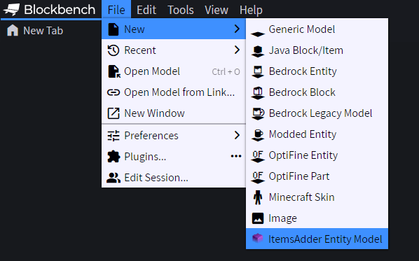<figcaption></figcaption></figure>

本例命名为 `ceiling_fan`。

<figure>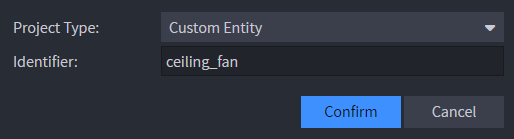<figcaption></figcaption></figure>

创建模型。

<figure>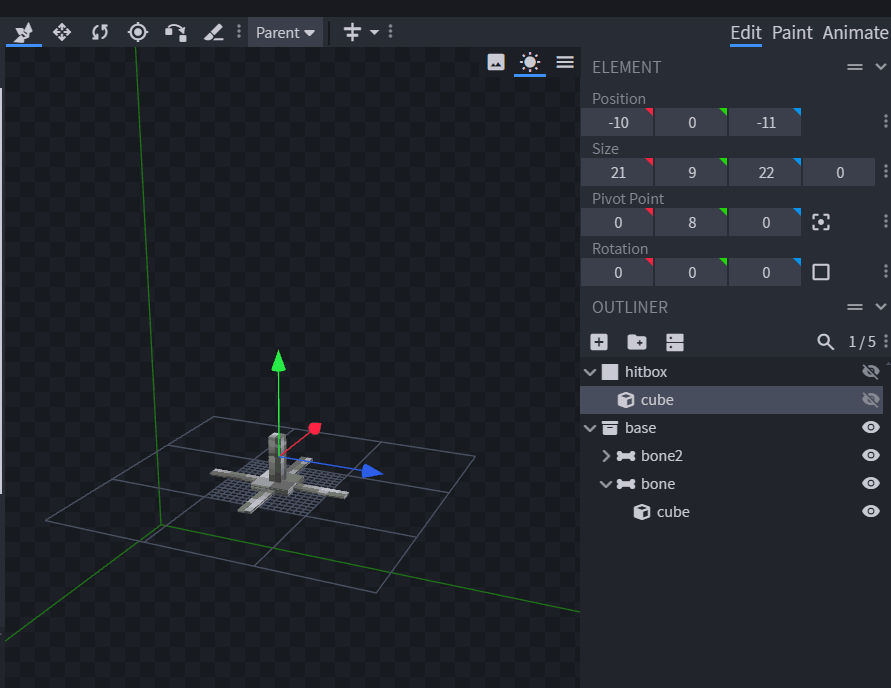<figcaption></figcaption></figure>

切换到动画面板。

<figure>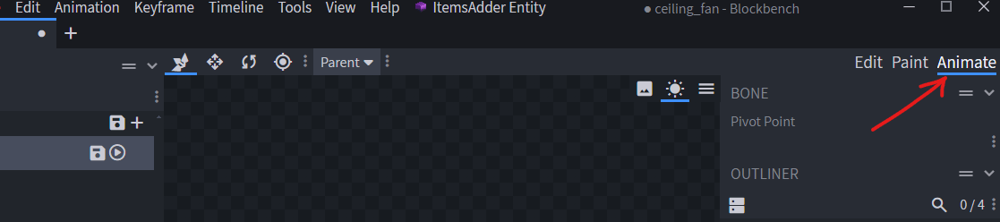<figcaption></figcaption></figure>

创建新的 `idle` 动画。

<figure>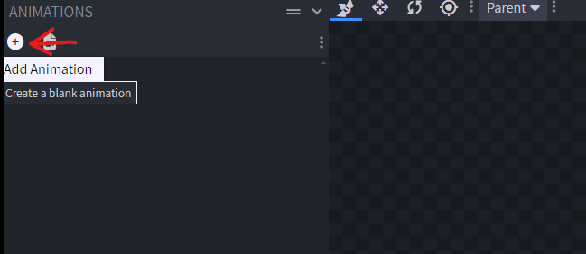<figcaption></figcaption></figure>

<figure>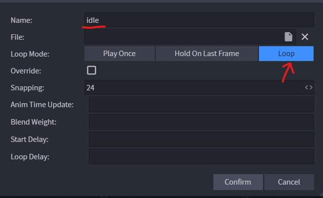<figcaption></figcaption></figure>

按需为实体制作动画。

<figure>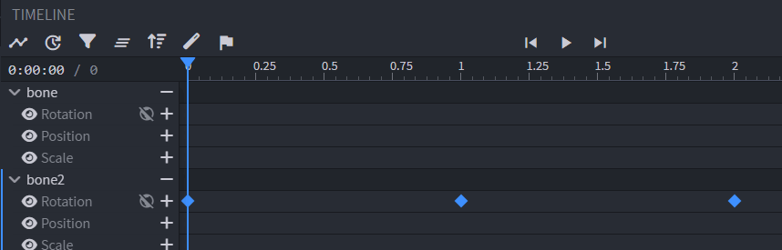<figcaption></figcaption></figure>

打开实体设置并填写正确命名空间，本例使用 `my_furniture`。

<figure>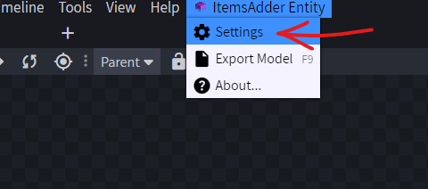<figcaption></figcaption></figure>

<figure>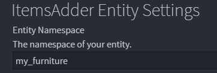<figcaption></figcaption></figure>

将工程保存到命名空间文件夹根目录，例如命名为 `ceiling_fan.iaentity`。\
以后可以随时编辑。

<figure>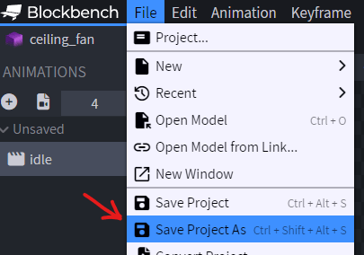<figcaption></figcaption></figure>

<figure>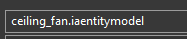<figcaption></figcaption></figure>

导出模型，ItemsAdder 将加载这个模型文件。

<figure>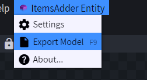<figcaption></figcaption></figure>

在游戏中使用 `/iaget my_furniture:ceiling_fan` 获取物品。

<figure>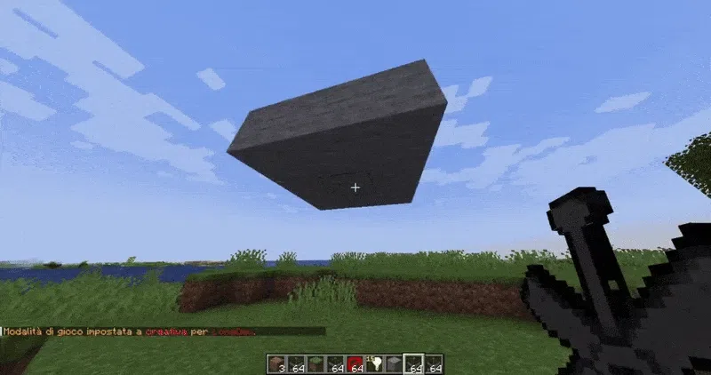<figcaption></figcaption></figure>
# 复杂家具示例包

可从[这里](https://www.spigotmc.org/resources/iaentities-animated-furniture-for-itemsadder.137775/)下载一个复杂家具示例包


