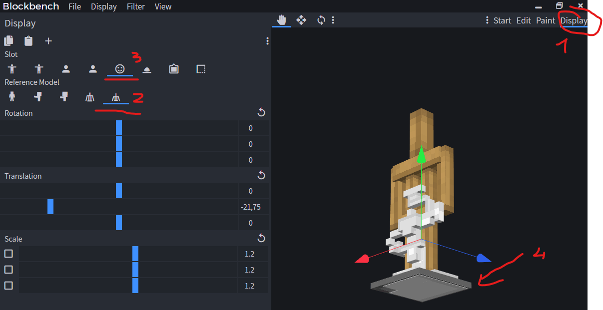
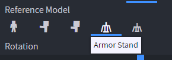
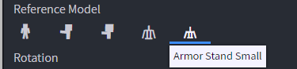

# 家具尺寸

**建议使用小型家具（小型盔甲架）**

## 如何调整家具放置时的位置？

要调整位置，照常使用 Blockbench，然后：



1. 点击右侧的 **display**
2. 点击左侧的 **盔甲架图标**
3. 点击左侧的 **笑脸**（**头部**）
4. 将你的模型移动到盔甲架的 **底部**（即 **地面**）

### 太小的家具

如果你的家具**太小**但你希望它**更大**并且有更大的**碰撞箱**，只需将此设置为 **false**。\
如果你希望一个**小家具**有小碰撞箱，只需将其设置为 true。

注意：碰撞箱没有限制，你可以设置一个更大的碰撞箱，它将与实体本身无关。

设置碰撞箱属性:

```yaml
    hitbox:
      height: 2
      length: 3
      width: 3
```

```yaml
behaviours:
  furniture:
    small: false
```

```yaml
behaviours:
  furniture:
    small: true
```

#### 并在 BlockBench 中设置以下内容




