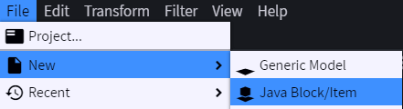
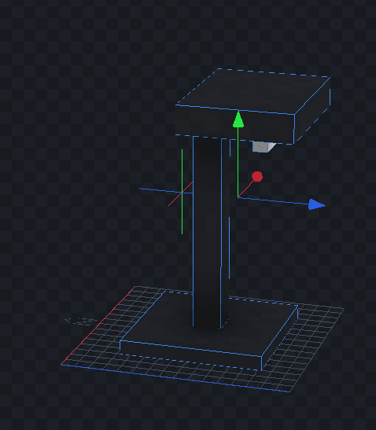
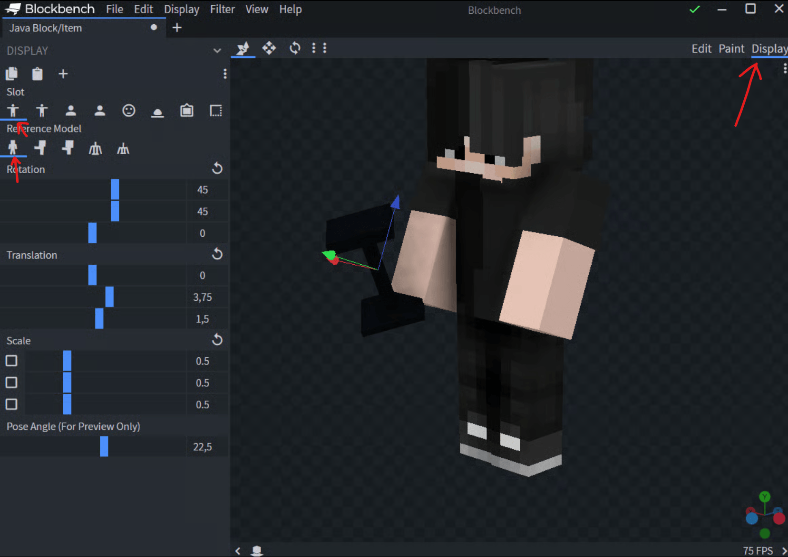
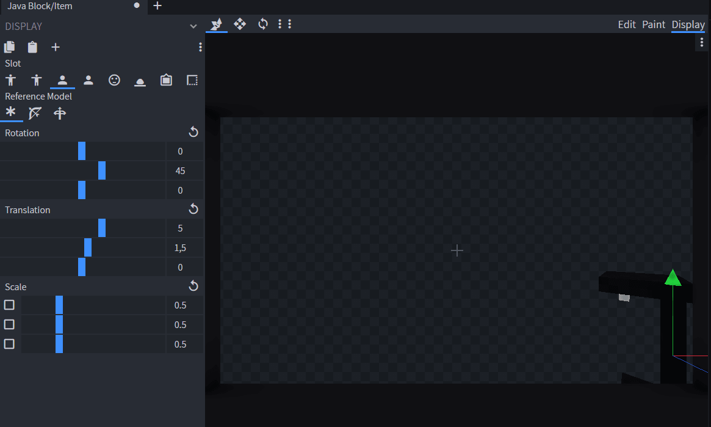
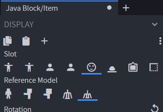
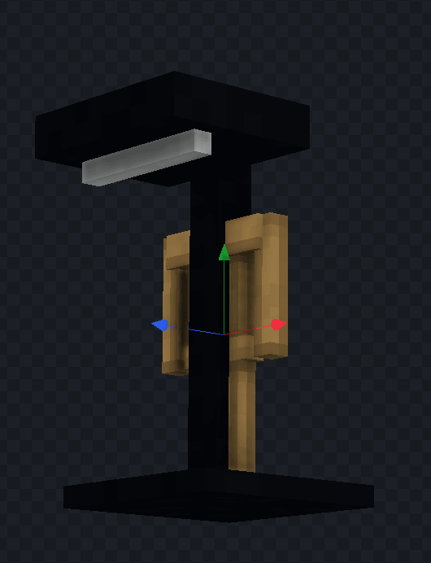
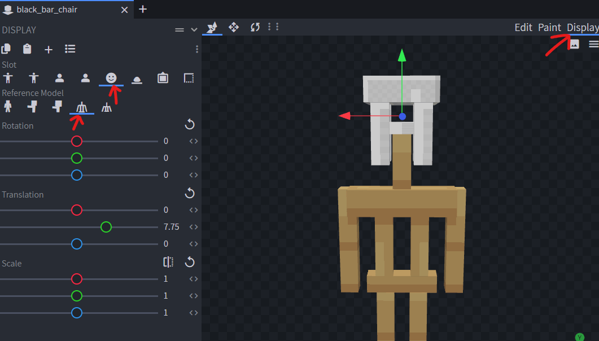
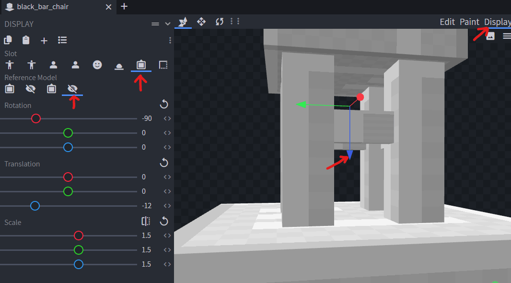

# 模型

### 模型文件

打开 **BlockBench**，创建 _“Java Block/Item”_。



创建模型，本例制作一盏简陋的极简现代灯。



重要：确认 north 方向与希望模型朝向的方向相反。

也可以在 YML 配置中添加属性 `opposite_direction: true`

编辑模型在玩家手中的显示方式：

<div><figure><figcaption></figcaption></figure></div>



### 配置游戏内显示

#### 使用 `armor_stand`

选择**头部图标**，然后选择 **small ArmorStand：**



将模型下移，直到与 **ArmorStand** 底座对齐：



#### 使用 `item_display`

此模式的性能最好

确认配置中指定了 `HEAD`。

```yaml
    behaviours:
      furniture:
        entity: item_display
        display_transformation:
          transform: HEAD
        gravity: false
        fixed_rotation: false
```

选择**头部图标**，然后选择普通 **ArmorStand**。

移动模型，使其大致如下图所示，靠近地面。之后可以重新生成资源包，在游戏中预览并继续移动模型，直到位置正确。

<figure><figcaption></figcaption></figure>

#### 使用 `item_frame`

选择 _Frame_ 和 _Invisible Top_。\
调整模型 Z 轴的 _Translation_（蓝色箭头），直到与白色方块底部完全对齐。

<figure><figcaption></figcaption></figure>

### 导出模型

将模型保存到正确的文件夹。本例在 `.yml` 配置文件中设置 `model_path: lamp`，因此应将 `.json` 文件保存到 `contents/myitems/models/lamp.json`。

依次点击“File”“Export Model”“Export Block/Item Model”。在新窗口中进入模型保存路径，填写正确名称并确认。
