# 动态 3D 物品

## 创建动画模型

本教程使用 [BlockBench](https://blockbench.net/) 创建模型，操作简单、速度快。\
YouTube 上有 [BlockBench 教程](https://www.youtube.com/results?search_query=blockbench+tutorial)可供参考。

创建模型时务必选择 Java 方块／物品模型！请勿使用基岩版模型或实体模型。

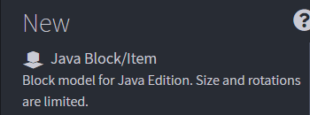

## 创建简单动画

例如，下图的模型由几个立方体组成。

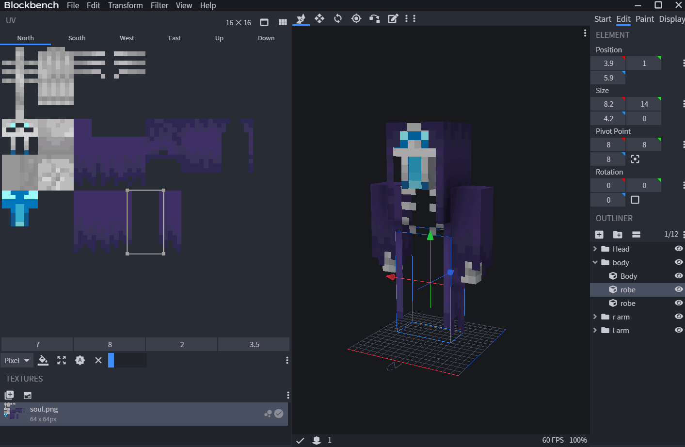

接下来为它添加动画！\
本例让模型上下悬浮。

### 将**当前模型保存**到临时文件夹（电脑上的任意位置）

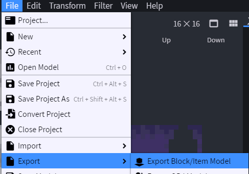

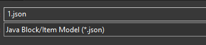

将它保存为临时文件夹中的 **1.json**，作为**动画**的第一帧。

### 返回 **BlockBench**，按 **`CTRL+A`** 全选

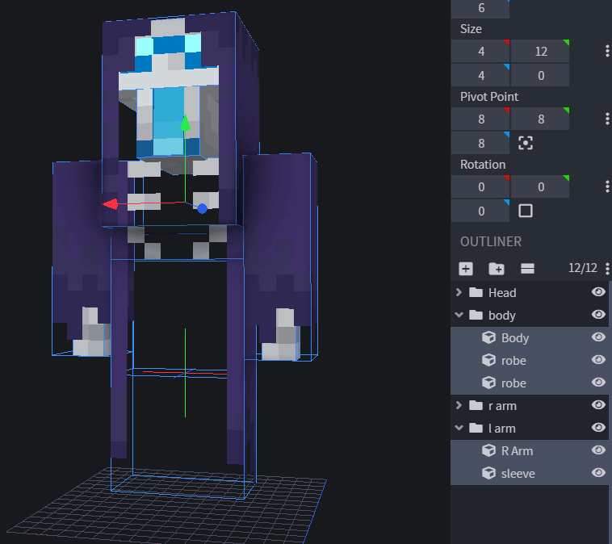

**按住鼠标左键**拖动<mark style="color:green;">**绿色**</mark>箭头，同时**按住 `CTRL`**，将鼠标稍微向**上**移动。

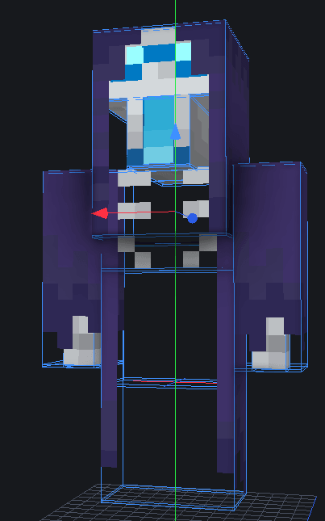

再次**保存**文件，并将文件名改为 `2.json`。\
对所需的每一帧重复此操作。每个模型文件保存动画的一帧。

### 将模型合并为一个 `.json` 动画

创建好动画所需的帧后，打开[此网站](https://lonedev6.github.io/animated-models/)。\
**点击图标**加载 `json` 帧文件。

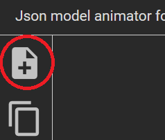

点击 **`Choose files...`**，选择 `json` 文件（各帧）和 `png` 纹理。

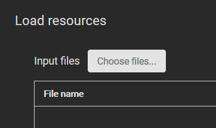

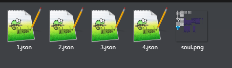

点击 **`LOAD`**。

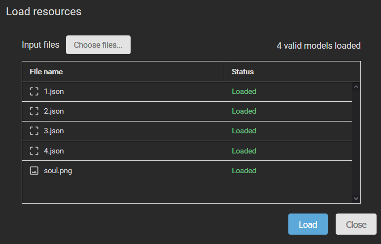

**点击复制图标**（第二个图标），把这 **4 个文件拖放**到底部一行。

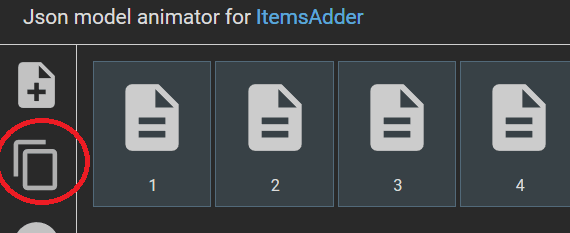

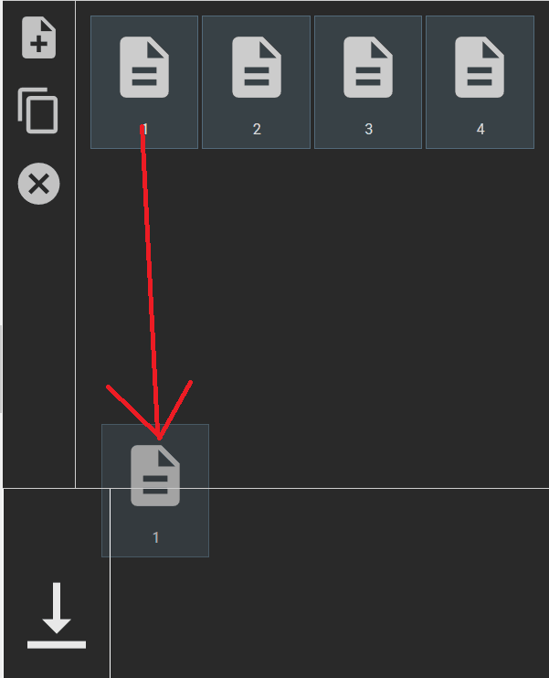

结果应如下图所示。

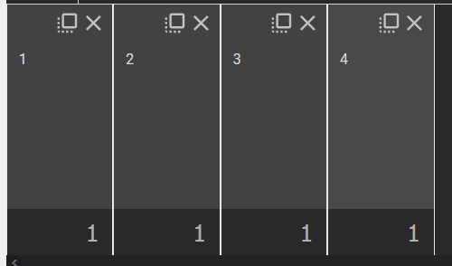

再按相反顺序拖放一次（3、2；这里跳过 1 和 4，因为重复它们对动画没有作用）。

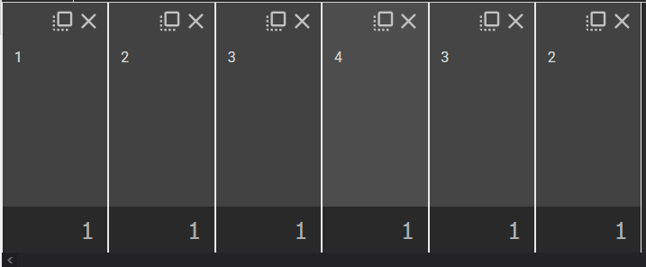

点击**左下角的播放按钮**预览动画。

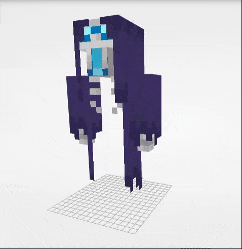

点击**右上角**的 **`Export`**，填写模型路径，之后配置中需要引用它，再次点击 **`Export`**。

<figure>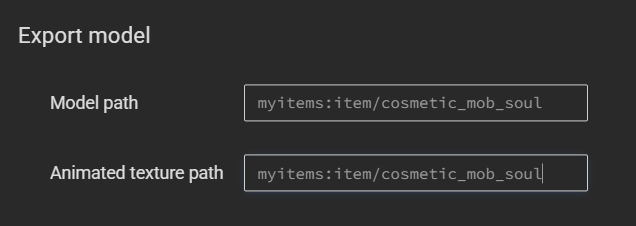<figcaption></figcaption></figure>

此时会生成包含动画的 **`zip`** 文件，**下载并打开**它。

将 `zip` 中的 `models` 文件夹**解压**到 **ItemsAdder** 的内容目录，例如 `contents\myitems\models\`。

将物品配置为使用待机动画，而非静止模型：`item/cosmetic_mob_soul`。

```yaml
info:
  namespace: myitems
items:
  cosmetic_mob_soul:
    display_name: Cosmetic Mob Soul
    permission: my_items
    resource:
      generate: false
      model_path: "item/cosmetic_mob_soul"
```

使用命令 `/iazip`（如果使用 external-host，请仔细按照[教程](../../plugin-usage/plugin-configuration/resourcepack-hosting.md)操作）。

请勿用 BlockBench 或其他编辑器打开网站导出的动画模型，否则可能损坏并停止工作。

可以删除 1-2-3-4.json（也可以备份以便以后修改）；实际使用只需要 idle.json，以及作为动画资源的 png 和 mcmeta 文件。
