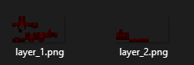
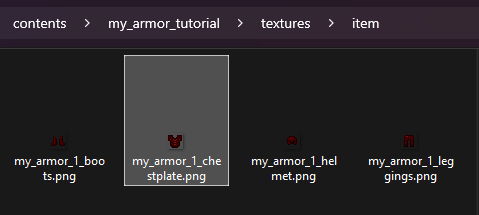
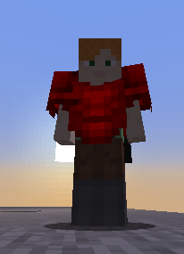
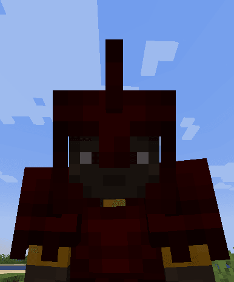
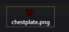
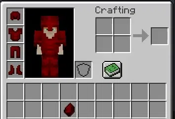
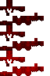
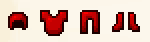
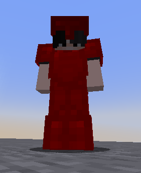

# 盔甲

#### 穿戴纹理配置

```yaml
equipments:
  my_armor_1:
    type: armor
    layer_1: armor/my_armor_1/layer_1
    layer_2: armor/my_armor_1/layer_2
```

`equipment` 属性包含盔甲在游戏中显示于玩家身体上所需的信息。

在以下文件夹创建各层文件：`contents/my_armor_tutorial/textures/armor/my_armor_1`。

<figure><figcaption></figcaption></figure>

#### 物品配置

本例演示创建**胸甲**；其他盔甲部件可使用相同方法。

```yaml
  my_armor_1_chestplate:
    name: My Armor 1 Chestplate
    material: IRON_CHESTPLATE
    graphics:
      texture: item/my_armor_1_chestplate
    durability:
      max_durability: 165
    equipment:
      id: my_armor_tutorial:my_armor_1
      slot_attribute_modifiers:
        armor: 1
```

这里将 `material` 设为 `IRON_CHESTPLATE`。

同时将 `equipment.id` 设为 `my_armor_tutorial:my_armor_1`。\
这会加载前面创建的装备设置。

#### 背包物品纹理

创建物品纹理，并放入以下文件夹：\
`contents/my_armor_tutorial/textures/item`.

<figure><figcaption></figcaption></figure>



#### 补充：自定义 3D 头盔

受 Minecraft 的限制，目前只有头盔支持 3D 模型。

```yaml
  my_armor_1_helmet_3d:
    name: My Armor 1 Helmet 3D
    material: IRON_HELMET
    graphics:
      model: armor/my_armor_1_helmet_3d
    durability:
      max_durability: 165
    equipment:
      slot_attribute_modifiers:
        armor: 2.5
```

不要在 `equipment` 中设置 `id`，否则会使用前面的分层纹理，而不是自定义 `model_path`。

<figure><figcaption></figcaption></figure>

**前面示例的完整配置**

<details>

<summary>点击查看完整配置文件</summary>

```yaml
info:
  namespace: my_armor_tutorial
equipments:
  my_armor_1:
    type: armor
    layer_1: armor/my_armor_1/layer_1
    layer_2: armor/my_armor_1/layer_2
items:
  my_armor_1_helmet:
    name: My Armor 1 Helmet
    material: IRON_HELMET
    graphics:
      texture: item/my_armor_1_helmet
    durability:
      max_durability: 165
    equipment:
      id: my_armor_tutorial:my_armor_1
      slot_attribute_modifiers:
        armor: 2.5
  my_armor_1_chestplate:
    name: My Armor 1 Chestplate
    material: IRON_CHESTPLATE
    graphics:
      texture: item/my_armor_1_chestplate
    durability:
      max_durability: 165
    equipment:
      id: my_armor_tutorial:my_armor_1
      slot_attribute_modifiers:
        armor: 1
  my_armor_1_leggings:
    name: My Armor 1 Leggings
    material: IRON_LEGGINGS
    graphics:
      texture: item/my_armor_1_leggings
    durability:
      max_durability: 165
    equipment:
      id: my_armor_tutorial:my_armor_1
      slot_attribute_modifiers:
        armor: 2.5
  my_armor_1_boots:
    name: My Armor 1 Boots
    material: IRON_BOOTS
    graphics:
      texture: item/my_armor_1_boots
    durability:
      max_durability: 165
    equipment:
      id: my_armor_tutorial:my_armor_1
      slot_attribute_modifiers:
        armor: 2.5

```

</details>

#### 动画／自发光盔甲

当前的自定义盔甲方法不支持动画和自发光纹理。\
如需动画或自发光纹理，请使用旧版纹理方法（依赖着色器）。

#### **高清盔甲纹理**

本游戏采用方块风格，原作者不建议使用高清纹理。如需制作，请确保宽高比例与原版盔甲分层纹理一致。

<mark style="color:red;">**尺寸必须是 2 的幂**</mark>，例如：64x32、128x64、256x128、512x256。

#### 将旧盔甲转换为新的 equipment 标签

此选项会将盔甲完全转换为使用新 equipment 标签。低于 1.21.2 的旧版客户端将不再显示这些盔甲。

```yaml
advanced:
    completely_convert_to_new_equipment_tag:
      enabled: true
      new_armor_material: IRON
```

#### 自定义穿戴纹理

`vanilla` 功能需要 Minecraft 1.17 或更高版本。\
Minecraft 1.16 及更早版本不支持此功能。

若希望 1.16 客户端也能显示自定义盔甲，可同时启用 `optifine` 属性。

使用自定义光影的玩家也可采用此方式，因为自定义光影通常与自定义盔甲使用的原版着色器不兼容。

若安装 **Optifine** 后纹理**异常**，请阅读[此页](../../faq/armors-issues/armors-textures-not-working-with-shaders-mod.md)。

**创建盔甲渲染器**

盔甲渲染器保存盔甲在游戏中显示于玩家身体上的设置。\
该配置决定游戏如何渲染盔甲。

注意：每种颜色只能对应一个盔甲渲染器。

```yaml
info:
  namespace: my_items
armors_rendering:
  my_armor:
    color: "#d60000"
    layer_1: armor/my_armor/layer_1
    layer_2: armor/my_armor/layer_2
    use_color: false
```

必须选择一种颜色，即使不打算给盔甲染色。颜色相当于自定义盔甲渲染器的 ID（标识符）。

* `use_color: false` 会关闭使用 `color: "#d60000"` 对盔甲重新着色的功能；设为 `true` 时会给纹理染色。\
  若希望用指定的 `color` 给盔甲染色，请将它设为 `true`。\
  此选项也会让背包中的物品不再自动染色。
* `color` 是该盔甲的颜色属性。\
  它作为盔甲的**唯一标识符**；当 `use_color` 为 `true` 时，还会给盔甲染色。可使用[此网站](https://minecraftcommand.science/armor-color)获取有效颜色值。\
  注意：若选中的颜色已被其他自定义盔甲占用，ItemsAdder 会自动选择最接近的未使用颜色。

接着在 `contents/my_items/textures/armor/my_armor/` 文件夹中创建两个 PNG 文件。

<figure><figcaption></figcaption></figure>

**高清盔甲纹理**

也可以创建高分辨率盔甲！\
请确保宽高比例与原版一致。\
例如：\
64x32、128x64、256x128、512x256……<mark style="color:red;">尺寸必须是 2 的幂，这一点非常重要。</mark>

原作者不太建议在方块风格的游戏中使用高清纹理。\
大量高清纹理可能引发问题，不同显卡支持的尺寸上限也不同。

如需降低出错风险，建议保持原版纹理尺寸。

**创建盔甲部件**

下面创建一件胸甲。\
创建其他部件时，重复以下方法并修改 `slot` 即可。

```yaml
  my_armor_chest:
    display_name: my_armor chestplate
    permission: my_armor
    resource:
      generate: true
      textures:
      - item/my_armor/chestplate
    durability:
      max_custom_durability: 400
    specific_properties:
      armor:
        slot: chest
        custom_armor: my_armor
    attribute_modifiers:
      chest:
        armor: 7
        armorToughness: 1
```

请确保没有设置 `material` 属性。自定义纹理盔甲的材质由插件自动处理；手动设置 `material` 会使盔甲失效。

`custom_armor` 属性会让插件将前面定义的 `armors_renderer` 应用到该盔甲部件。

这里没有在部件的 `specific_properties` 中设置 `color`，因为 `custom_armor` 会从 `armors_renderer` 继承并自动应用颜色。

接着创建物品纹理并放入以下文件夹：\
`contents/my_items/textures/item/my_armor/`.

本例额外创建了 `my_armor` 文件夹以便整理资源包。每个盔甲部件各有 1 张纹理，全部放在同一纹理目录中容易混淆。

`contents/my_items/textures/item/my_armor/chestplate.png`




**动画纹理**

也可以创建带动画的盔甲！



创建动画盔甲时，需要把所有动画帧放在同一张图片中。\
每帧必须排列在上一帧下方。下面是一个 3 帧动画示例：




接下来修改渲染属性以支持动画。

```yaml
info:
  namespace: my_items
armors_rendering:
  my_armor:
    color: "#d60000"
    layer_1: armor/my_armor/layer_1
    layer_2: armor/my_armor/layer_2
    use_color: false
    animation:
      interpolation: true
```

这里设置 `interpolation: true`，让动画平滑过渡。

默认速度为 24，可以调整到合适的数值：

```yaml
    animation:
      speed: 30
      interpolation: true
```

**自发光纹理（在暗处发光）**

也可以创建在暗处发光的自发光纹理，并同时使用动画与自发光效果！

```yaml
info:
  namespace: my_items
armors_rendering:
  my_armor:
    color: "#d60000"
    layer_1: armor/my_armor/layer_1
    layer_2: armor/my_armor/layer_2
    emissive_1: armor/my_armor/emissive_1
    emissive_2: armor/my_armor/emissive_2
    use_color: false
```

本例为前面的动画添加自发光效果，使其在暗处发光。\
需要准备 2 张纹理才能实现发光。\
**透明**部分**不会发光**，有颜色的部分会发光。

复制原纹理，再擦除不需要发光的区域即可。

#### 补充：自定义 3D 头盔

受 Minecraft 限制，目前只有装备在头上的物品支持 3D 模型。

下面展示如何创建使用 3D 模型而非普通纹理的自定义头盔。

```yaml
info:
  namespace: my_items
items:
  test_3d_helmet:
    display_name: Test 3D Helmet
    resource:
      generate: false
      model_path: item/test_3d_helmet
      material: PAPER
    durability:
      max_durability: 1562
    behaviours:
      hat: true
```

请使用 `PAPER` 等 `material`，避免使用原版头盔材质，否则穿戴后看不到 3D 模型。

自定义头盔的耐久度支持需要 ItemsAdder 4.0.8+。

#### 前面示例的完整配置

<details>

<summary>点击查看完整配置文件</summary>

```yaml
info:
  namespace: myitems
armors_rendering:
  myarmor:
    color: "#d60000"
    layer_1: armor/myarmor/layer_1
    layer_2: armor/myarmor/layer_2
items:
  myarmor_helmet:
    display_name: myarmor helmet
    permission: myarmor
    resource:
      generate: true
      textures:
      - item/myarmor/helmet
    durability:
      max_custom_durability: 275
    specific_properties:
      armor:
        slot: head
        custom_armor: myarmor
    attribute_modifiers:
      head:
        armor: 9
        armorToughness: 1
  myarmor_chestplate:
    display_name: myarmor chestplate
    permission: myarmor
    resource:
      generate: true
      textures:
      - item/myarmor/chestplate
    durability:
      max_custom_durability: 400
    specific_properties:
      armor:
        slot: chest
        custom_armor: myarmor
    attribute_modifiers:
      chest:
        armor: 7
        armorToughness: 1
  myarmor_leggings:
    display_name: myarmor leggings
    permission: myarmor
    resource:
      generate: true
      textures:
      - item/myarmor/leggings
    durability:
      max_custom_durability: 375
    specific_properties:
      armor:
        slot: legs
        custom_armor: myarmor
    attribute_modifiers:
      legs:
        armor: 5
        armorToughness: 1
  myarmor_boots:
    display_name: myarmor boots
    permission: myarmor
    resource:
      generate: true
      textures:
      - item/myarmor/boots
    durability:
      max_custom_durability: 325
    specific_properties:
      armor:
        slot: FEET
        custom_armor: myarmor
    attribute_modifiers:
      feet:
        armor: 3
        armorToughness: 1
```

</details>

将 zip 解压到 ItemsAdder 的 `contents` 文件夹。

#### 常见问题

ItemsAdder 4.0.9 将 `armors_rendering` 更名为 `legacy_armor_renderings`。\
为保持兼容，旧属性名仍然有效。

这类简单盔甲无需纹理。ItemsAdder 会根据指定颜色自动生成外观，形状类似铁质／钻石盔甲，但颜色不同。

**创建盔甲部件**

下面创建一件胸甲。\
创建其他部件时，重复以下方法并修改 `slot` 即可。

```yaml
  my_armor_simple_chestplate:
    display_name: my_armor_simple chestplate
    permission: myarmor
    resource:
      generate: true
    durability:
      max_custom_durability: 400
    specific_properties:
      armor:
        slot: chest
        color: '#ff0001'
    attribute_modifiers:
      chest:
        armor: 7
        armorToughness: 1
```

`color` 属性决定盔甲在游戏中的颜色。

#### 完成！

无需其他操作，已经创建了一件不需要绘制纹理的简单盔甲！

<figure><figcaption></figcaption></figure>

<figure><figcaption></figcaption></figure>

#### 前面示例的完整配置

<details>

<summary>点击查看完整配置文件</summary>

```yaml
info:
  namespace: my_items
items:
  my_armor_simple_helmet:
    display_name: my_armor_simple helmet
    permission: my_armor_simple
    resource:
      generate: true
    durability:
      max_custom_durability: 275
    specific_properties:
      armor:
        slot: head
        color: '#ff0001'
    attribute_modifiers:
      head:
        armor: 9
        armorToughness: 1
  my_armor_simple_chestplate:
    display_name: my_armor_simple chestplate
    permission: myarmor
    resource:
      generate: true
    durability:
      max_custom_durability: 400
    specific_properties:
      armor:
        slot: chest
        color: '#ff0001'
    attribute_modifiers:
      chest:
        armor: 7
        armorToughness: 1
  my_armor_simple_leggings:
    display_name: my_armor_simple leggings
    permission: myarmor
    resource:
      generate: true
    durability:
      max_custom_durability: 375
    specific_properties:
      armor:
        slot: legs
        color: '#ff0001'
    attribute_modifiers:
      legs:
        armor: 5
        armorToughness: 1
  my_armor_simple_boots:
    display_name: my_armor_simple boots
    permission: myarmor
    resource:
      generate: true
    durability:
      max_custom_durability: 325
    specific_properties:
      armor:
        slot: FEET
        color: '#ff0001'
    attribute_modifiers:
      feet:
        armor: 3
        armorToughness: 1
```

</details>

将 zip 解压到 ItemsAdder 的 `contents` 文件夹。
