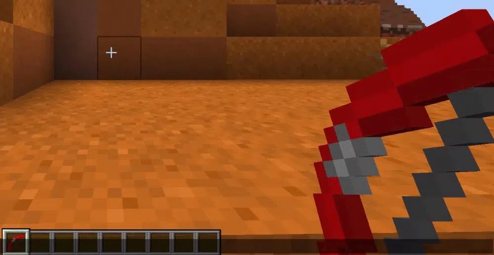
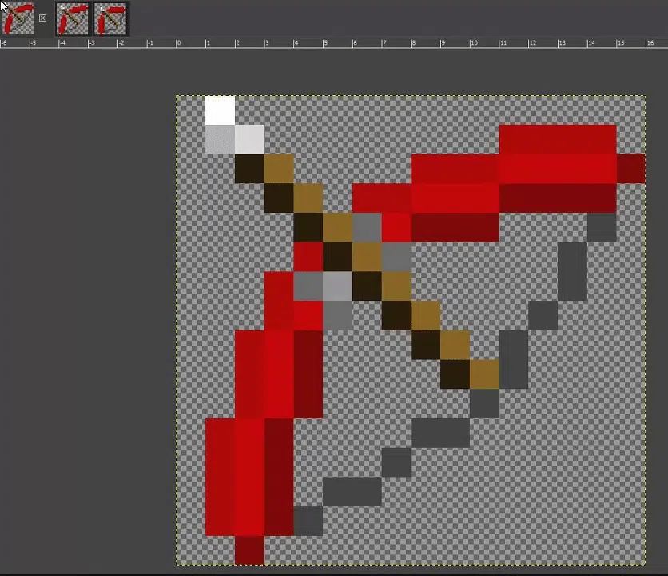
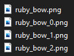
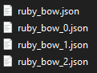
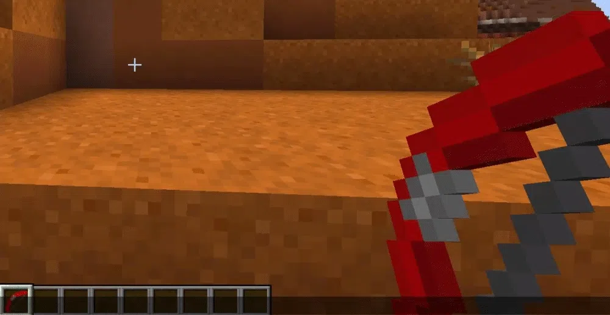

# 弓

拉弓时会播放状态动画，每个状态都可以使用独立的纹理或模型。

务必为弓配置所需纹理，避免出现纹理缺失：



要使用不同状态的纹理，请在模型文件名或纹理文件名后添加后缀。

使用纹理（png）时，设置 `generate: true`。\
使用已有模型（json）时，设置 `generate: false`。

## 物品状态后缀

* `BOW`
  * `_0` —— 第一阶段拉弓状态。
  * `_1` —— 第二阶段拉弓状态。
  * `_2` —— 第三阶段拉弓状态。
* `FISHING_ROD`
  * `_cast` —— 钓鱼竿抛出后的状态。
* `SHIELD`
  * `_blocking` —— 盾牌格挡状态。
* `BUNDLE`
  * `_filled` —— 收纳袋装有物品时的状态。

## 使用后缀添加物品状态（弓）

首先为弓创建三种拉弓状态。



保存后，将它们放入原始弓纹理所在目录，并按下图添加文件名后缀：

本例将纹理放在资源包的 `contents/myitems/textures/item/` 文件夹。

<div align="left"></div>

这些后缀也适用于模型（json）文件名。\
本例将模型放在资源包的 `contents/myitems/models/item/` 文件夹。



```yaml
items:
  ruby_bow:
    name: Example Ruby Bow
    material: BOW
    graphics:
      textures:
        normal: item/bows/ruby_bow
        pulling_0: item/bows/ruby_bow_0
        pulling_1: item/bows/ruby_bow_1
        pulling_2: item/bows/ruby_bow_2
```

```yaml
items:
  ruby_bow:
    display_name: Example Ruby Bow
    resource:
      material: BOW
      generate: true
      textures:
        - item/bows/ruby_bow
```

## 完成

现在这把弓已经可以显示不同的物品状态。


