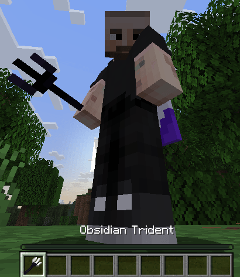

# 2D 图标

本节介绍面向低于 1.21.4 版本客户端的方法。

ItemsAdder 4.0.13+ 和 Minecraft 1.21.4+ 支持新的 2D 图标制作方式。\
[更多信息](../modern-items-creation.md#icon)。

本功能需要 Minecraft 1.21.2 或更高版本客户端，服务端版本不影响这一要求。

支持更早客户端的方法见以下教程：

* [方块 2D 图标](../../blocks/block-2d-icon.md)
* [家具 2D 图标](../../furnitures/furniture-2d-icon.md)

## `icon` 属性

只需把 icon 属性设为有效纹理路径。\
这样就完成了！

### 示例

```yaml
info:
  namespace: test
items:
  obsidian_trident:
    name: Obsidian Trident
    resource:
      generate: false
      model_path: item/obsidian_trident
      material: TRIDENT
      icon: item/obsidian_trident
```

注意：

模型 `item/obsidian_trident` 与纹理 `item/obsidian_trident` 名称相同，但它们是两个不同的文件。

采用相同名称只是为了方便整理。

本例中：

* `item/obsidian_trident` 对应 `contents/test/models/item/obsidian_trident.json`。
* `item/obsidian_trident` 对应 `contents/test/textures/item/obsidian_trident.png`。

<div><figure><figcaption></figcaption></figure></div>
