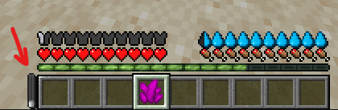
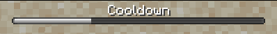

# 动作

## 什么是动作？

[事件](events.md)触发后执行的内容称为动作。

可通过[官方编辑器](../../../plugin-usage/beginners/files-editor.md)查看可用动作列表。

## `events_settings`

这类特殊物品属性用来调整事件的行为。

### 冷却时间

可以设置冷却时间，在此期间玩家无法触发该物品的任何动作。\
适合限制玩家反复使用特殊物品。

```yaml
  healing_crystals:
    display_name: display-name-healing_crystals
    permission: healing_crystals
    ## .... item properties
    events_settings:
      cooldown:
        indicator: HUD
        ticks: 120
    events:
    ## .... your events
```

### 冷却指示器

可以自定义冷却指示器，并选择不同的显示类型：

#### HIDDEN（隐藏）

不显示指示器。

```yaml
  healing_crystals:
    display_name: display-name-healing_crystals
    permission: healing_crystals
    ## .... item properties
    events_settings:
      cooldown:
        indicator: HIDDEN
        ticks: 120
    events:
    ## .... your events
```

#### HUD（自定义界面）

在屏幕上显示自定义 HUD。

<figure><figcaption></figcaption></figure>

`custom_hud` 不是必填项；省略时使用内置 HUD `_iainternal:small_cooldown_bar`。

<mark style="color:red;">⚠️</mark> 请确保没有在 `config.yml` 中禁用 `extract_internal_utility_assets`！

```yaml
  healing_crystals:
    display_name: display-name-healing_crystals
    permission: healing_crystals
    ## .... item properties
    events_settings:
      cooldown:
        indicator: HUD
        ticks: 120
        custom_hud: my_items:custom_hud_1
    events:
    ## .... your events
```

如需制作自定义 HUD 又不想手工染色，可使用[此指南](../../../other/bulk-colorize-images.md)一键给图片着色。

#### TITLE（标题）

在屏幕上显示大标题指示器。

<figure><figcaption></figcaption></figure>

```yaml
  healing_crystals:
    display_name: display-name-healing_crystals
    permission: healing_crystals
    ## .... item properties
    events_settings:
      cooldown:
        indicator: TITLE
        ticks: 120
    events:
    ## .... your events
```

#### BOSSBAR（Boss 血条）

在屏幕上显示 Boss 血条。

<figure><figcaption></figcaption></figure>

`color` 和 `style` 不是必填项；省略时使用 `config.yml` 中的设置。

```yaml
  healing_crystals:
    display_name: display-name-healing_crystals
    permission: healing_crystals
    ## .... item properties
    events_settings:
      cooldown:
        indicator: BOSSBAR
        ticks: 120
        bossbar:
          color: WHITE
          style: SOLID
    events:
    ## .... your events
```

## 延迟

每个动作都有特殊属性 **delay**。\
它表示执行动作前等待的 tick 数。\
例如：

```yaml
items:
  chain_events:
    display_name: "%#FE5A00%chain_events"
    permission: test.chain_events
    resource:
      material: COAL
      generate: true
      textures:
      - "minecraft:item/diamond.png"
    events:
      interact:
        right:
          execute_commands:
            cmd1:
              command: 'tellraw {player} {"text":"Action 1","color":"gold"}'
              as_console: true
              delay: 0
            cmd2:
              command: 'tellraw {player} {"text":"Action 2","color":"gold"}'
              as_console: true
              delay: 20
            cmd3:
              command: 'tellraw {player} {"text":"Action 3","color":"gold"}'
              as_console: true
              delay: 40
          play_sound_1:
            name: minecraft:block.note_block.banjo
            delay: 0
          play_sound_2:
            name: minecraft:block.note_block.banjo
            pitch: 1.2
            delay: 20
          play_sound_3:
            name: minecraft:block.note_block.banjo
            pitch: 1.5
            delay: 40
```

## 同类型的多个动作

可以配置多次同类型动作，只需在名称后面加上 `_anything` 形式的后缀。\
例如，播放两个声音可以这样写：

```yaml
play_sound_first:
  name: itemsadder:ambient.creepy
  volume: 1
  pitch: 1
play_sound_second:
  name: minecraft:ambient.cave
  volume: 1
  pitch: 1
play_sound_3:
  name: minecraft:ambient.cave
  volume: 1
  pitch: 1
```

## 动作权限

每个动作都有特殊属性 **permission**。\
它表示玩家执行此**动作**前必须拥有的**权限**。\
例如，玩家必须拥有 `myitems.usage.secret_items_dispenser` 权限才会播放声音。\
注意：这个示例存在一个问题。\
即使玩家没有获取物品的权限，声音仍会播放，因为权限检查只应用于 `give_item`。

```yaml
  test_block:
    display_name: display-name-test_block
    permission: test_block
    resource:
      material: PAPER
      generate: true
      textures:
      - block/test_block.png
    behaviours:
      block:
        placed_model:
          type: REAL_NOTE
          break_particles_material: SMITHING_TABLE
    events:
      placed_block:
        interact:
          give_item:
            permission: "myitems.usage.secret_items_dispenser"
            item: DIAMOND
          play_sound:
            name: itemsadder:ambient.creepy
            volume: 1
            pitch: 1
```

**为全部动作设置相同权限**

如需为全部动作设置同一权限，无需反复复制粘贴。\
可使用特殊属性 `all_actions_permission`。\
例如：

```yaml
  test_block:
    display_name: display-name-test_block
    permission: test_block
    resource:
      material: PAPER
      generate: true
      textures:
      - block/test_block.png
    behaviours:
      block:
        placed_model:
          type: REAL_NOTE
          break_particles_material: SMITHING_TABLE
    all_actions_permission: "myitems.usage.secret_items_dispenser"
    events:
      placed_block:
        interact:
          give_item:
            item: DIAMOND
      play_sound:
        name: itemsadder:ambient.creepy
        volume: 1
        pitch: 1
```

## 自定义执行流程

插件可以在特定条件下跳过动作，具体规则见下文。\
这样可以进一步自定义物品逻辑。

例如，制作一根魔杖：成功攻击生物时播放一种声音，攻击失败时播放另一种声音。


<details>

<summary>魔杖示例代码（点击展开）</summary>

```yaml
info:
  namespace: actions_flow_test
items:
  magic_wand:
    display_name: Test Magic Wand
    resource:
      generate: false
      model_path: minecraft:item/stick
      material: STONE_SWORD
    events:
      interact_mainhand:
        left:
          # Damage the entity in sight
          damage_entity_in_sight:
            damage: 1
            distance: 8
          # Decrement durability only if the attack is successful
          decrement_durability:
            amount: 1
            flow:
              skip_if_fail: damage_entity_in_sight
          # Play sound only if the attack is successful
          play_sound:
            name: block.amethyst_cluster.step
            volume: 1.5
            pitch: 1
            flow:
              skip_if_fail: damage_entity_in_sight
          # Play sound only if the attack is successful
          shoot_particle:
            name: CRIT_MAGIC
            distance: 7
            flow:
              skip_if_fail: damage_entity_in_sight
          # Play sound only if the attack is failed
          play_sound_fail:
            name: minecraft:block.wool.break
            volume: 1
            pitch: 2
            flow:
              skip_if_success: damage_entity_in_sight
          # Play sound only if the attack is failed
          shoot_particle_fail:
            name: CRIT
            distance: 7
            flow:
              skip_if_success: damage_entity_in_sight
```

</details>

### 流程规则

#### `stop_if_last_success`

如果前一个动作**成功**，不执行当前动作及后续动作。

#### `stop_if_last_fail`

如果前一个动作**失败**，不执行当前动作及后续动作。

#### `skip_if_last_success`

如果前一个动作**成功**，跳过当前动作。

#### `skip_if_last_fail`

如果前一个动作**失败**，跳过当前动作。

#### `stop_if_any_success`

如果之前**任意**一个动作**成功**，不执行当前动作及后续动作。

#### `stop_if_any_fail`

如果之前**任意**一个动作**失败**，不执行当前动作及后续动作。

#### `skip_if_any_success`

如果之前**任意**一个动作**成功**，跳过当前动作。

#### `skip_if_any_fail`

如果之前**任意**一个动作**失败**，跳过当前动作。

#### `stop_if_success`

如果之前指定的动作**成功**，不执行当前动作及后续动作。

#### `stop_if_fail`

如果之前指定的动作**失败**，不执行当前动作及后续动作。

#### `skip_if_success`

如果之前指定的动作**成功**，跳过当前动作。

#### `skip_if_fail`

如果之前指定的动作**失败**，跳过当前动作。

### 特殊属性

`execute_commands` 有一个特殊属性 `flow_success_if_message_contains`，仅在 `as_console: true` 时生效。

它可以根据控制台输出判断命令是否成功，例如传送成功、设置方块成功等。

插件能自动识别原版命令的成功／失败，但其他插件命令的输出不固定，需要用该设置辅助判断。\
例如，原文以 `"failed to teleport"` 作为判断插件传送命令失败的输出示例。

### 使用原版 `execute if`

可以使用原版 `/execute if`，对计分板、方块等执行条件检查。

#### 示例

此物品只在 `example_score` 为 0 时，将玩家向上传送 2 格。

```yaml
info:
  namespace: test
items:
  test_flow:
    enabled: true
    display_name: test_flow
    resource:
      generate: false
      model_path: minecraft:item/diamond
      material: DIAMOND
    events:
      interact:
        right:
          execute_commands_1:
            cause_command:
              command: 'execute if score {player} example_score matches 0'
              as_console: true
              delay: 0
          execute_commands_2:
            effect_command:
              command: 'tp {player} ~ ~2 ~'
              as_console: true
            flow:
              skip_if_fail: execute_commands_1
```

此例检查玩家是否处于下界。

```yaml
execute_commands_1:
  cmd1:
    command: "execute at {player} if dimension minecraft:the_nether"
    as_console: true
```

此物品将 `~ ~-1 ~` 处的方块设为石头。\
命令成功时输出“Successfully set block!”。\
命令失败时完全跳过该消息。

```yaml
  test_flow_setblock:
    enabled: true
    display_name: test_flow_setblock
    resource:
      generate: false
      model_path: minecraft:item/diamond
      material: DIAMOND
    events:
      interact:
        right:
          execute_commands:
            cause_command:
              command: 'execute at {player} run setblock ~ ~-1 ~ stone'
              as_console: true
          execute_commands_2:
            effect_command:
              command: 'tellraw {player} {"text": "Successfully set block!"}'
              as_console: true
            flow:
              skip_if_fail: execute_commands
```

此物品会执行一条插件命令。\
ItemsAdder 无法自动识别其他插件命令的执行结果，需要指定一段用于判断状态的输出文本。\
例如，检查结果是否包含 `"Given item"`，以判断命令是否成功。

```yaml
  test_flow_plugin_command:
    enabled: true
    display_name: test_flow_plugin_command
    resource:
      generate: false
      model_path: minecraft:item/diamond
      material: DIAMOND
    events:
      interact:
        right:
          execute_commands:
            cause_command:
              command: 'iagive {player} iasurvival:end_ore'
              as_console: true
              flow_success_if_message_contains: "Given item"
          execute_commands_2:
            effect_command:
              command: 'tellraw {player} {"text": "Okay successfully given item!"}'
              as_console: true
            flow:
              skip_if_fail: execute_commands
```
