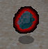
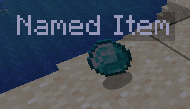

# 基础属性

## `enabled`

```yaml
enabled: true
```

此设置可以完全禁用某个物品。

禁用物品不会删除世界或背包中已有的该物品。

## `name`

```yaml
name: "Test"
```

物品提示框中显示的名称。

ItemsAdder 4.0.8 及更早版本使用 `display_name` 属性。

## `permission_suffix`

```yaml
permission_suffix: myitem
```

此属性决定玩家是否有权在 `/ia` 界面中查看该物品。\
例如，完整权限为 `ia.user.ia.seeitem.myitem`。

目前此权限仅用于上述用途。

[permission.md](permission.md)

## `lore`

```yaml
lore:
- '&7When you mine a block'
- '&7it drops exp orbs'
- '&750% of times.'
```

物品描述（Lore）各行文本。

## `enchants`

```yaml
enchants:
  - ARROW_FIRE:1
  - anger_artifact:1
  - my_custom_plugin:custom_enchant:6
```

物品的附魔。\
支持[原版附魔](https://hub.spigotmc.org/javadocs/bukkit/org/bukkit/enchantments/Enchantment.html)和其他插件提供的自定义附魔，例如 [EcoEnchants](../../../compatibility-with-other-plugins/compatible/ecoenchants.md)、[ExcellentEnchants](https://www.spigotmc.org/resources/goldenenchants-%E2%80%A2-more-vanilla-like-enchantments-1-14-1-16.61693/)。\
使用 NamespacedKey 创建自定义附魔时，也支持**命名空间**。

## `glint`

控制物品的附魔光泽是否可见。

```yaml
glint: false
```

## `attribute_modifiers`

```yaml
attribute_modifiers:
  mainhand:
    attackDamage: 19
    attackSpeed: 1.1
    maxHealth: 1.1
    movementSpeed: -1
    armor: 1.1
    armorToughness: 1.1
    attackKnockback: 1.1
    luck: 1.1
  offhand:
    attackDamage: 19
    attackSpeed: 1.1
    maxHealth: 1.1
    movementSpeed: 1.1
    armor: 1.1
    armorToughness: 1.1
    attackKnockback: 1.1
    luck: 1.1
```

这些是原版属性修饰符，更多说明见 [Minecraft 属性文档](https://minecraft.wiki/w/Attribute)。

## `durability`

```yaml
durability:
  max_durability: 200
  durability: 32
  disappear_when_broken: false
  unbreakable: false
  usages: 5
```

`usages`：当前物品的使用次数。记得通过[事件](events.md)减少此数值。

`durability`：物品的初始耐久度；省略时与 `max_durability` 相同。

`max_durability`：物品最大耐久度。

## `max_stack_size`

设置物品最大堆叠数量，默认继承原版材质的值。

## `item_flags`

```yaml
item_flags:
  - HIDE_ATTRIBUTES
  - HIDE_DESTROYS
  - HIDE_ENCHANTS
  - HIDE_PLACED_ON
  - HIDE_POTION_EFFECTS
  - HIDE_UNBREAKABLE
```

用于隐藏部分原版物品信息的特殊标记。\
完整列表见 [ItemFlag 文档](https://hub.spigotmc.org/javadocs/spigot/org/bukkit/inventory/ItemFlag.html)。

这是旧选项，受 Minecraft 1.20.4 改动影响，效果可能与早期游戏版本不同。

## `blocked_enchants`

禁用此物品的附魔。

```yaml
blocked_enchants:
- DAMAGE_UNDEAD
- DAMAGE_ALL
- DAMAGE_ARTHROPODS
- KNOCKBACK
- DURABILITY
- SWEEPING_EDGE
```

```yaml
blocked_enchants:
- ALL
```

## `events_needed_player_stats`

此特殊属性要求玩家的 ItemsAdder 属性值满足条件后才触发事件；这类属性通常显示在 HUD 中。可使用 `>`、`<` 和 `=`。

示例：[魔杖示例物品](../other-items-examples/magic-wand.md)。

## `glow`

可以让掉落在地上的物品显示发光轮廓。\
适合用于**稀有物品**。

需要 ItemsAdder 4.0.9 或更高版本。



```yaml
items:
  glowing_item:
    display_name: Glowing Item
    resource:
      material: DIAMOND
      generate: true
      textures:
      - item/glowing_item.png
    drop:
      glow:
        enabled: true
        color: DARK_RED
```

## `show_name`

可以让掉落物显示名称。\
适合用于**稀有物品**。



```yaml
  glowing_item:
    display_name: Glowing Item
    resource:
      material: DIAMOND
      generate: true
      textures:
      - item/glowing_item.png
    drop:
      show_name: true
```

## `template` 与 `variant_of`

[templates-and-variants.md](templates-and-variants.md)

## 使用官方文件编辑器查看全部属性

指南

