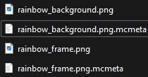
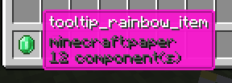
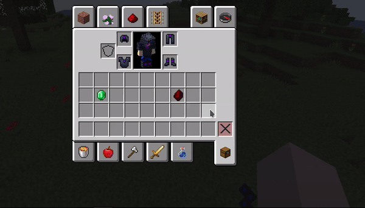

# 物品提示框

需要 ItemsAdder 4.0.9 或更高版本，且 Minecraft 客户端与服务端均至少为 1.21.2。

## 配置

```yaml
info:
  namespace: test_tooltip
items:
  tooltip_rainbow_item:
    display_name: tooltip_rainbow_item
    resource:
      generate: false
      model_path: minecraft:item/emerald
      material: PAPER
    tooltip_style: test_tooltip:tooltip/rainbow

```

## 图片文件

在 `contents/test_tooltip/textures/tooltip/` 中创建所需文件。

<figure><figcaption></figcaption></figure>

非动画图片尺寸应为 `100x100`，图片用于定义提示框对应部分的颜色。

`_background` 是背景，`_frame` 是边框。

提示框支持动画纹理（`.png.mcmeta` 文件）。

执行 `/iazip`，然后在游戏中获取该物品。

<figure><figcaption></figcaption></figure>

示例下载：

<details>

<summary>旧方法（1.21.2 之前）</summary>

#### 旧方法

可以为物品添加自定义纹理提示框，参考此示例附加包：\
[https://www.spigotmc.org/resources/items-custom-tooltip-texture-example-itemsadder-addon.87883/](https://www.spigotmc.org/resources/items-custom-tooltip-texture-example-itemsadder-addon.87883/).



#### 限制

<div class="admonition warning" markdown="1">
* 图片太小时，自定义附魔文本会超出边框，因此此方法不适合显示自定义附魔。
* 需要把全部文字绘制在提示框图片内，否则图片太小时文本会超出边框。
</div>

</details>
