# 发光效果

此功能需要 Minecraft 1.21.2 或更高版本客户端。

## 物品

这只是发光的视觉效果，并不会真的照亮周围环境，属于游戏本身的限制。

原作者表示未来可能尝试实现随玩家移动的平滑光源，目前尚无可行方案。

创建纹理。

<figure>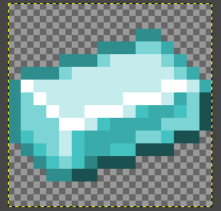<figcaption></figcaption></figure>

在 **Blockbench** 中创建新的 `Java Block/Item` 模型。

注意：本例把 `Parent Model` 设为 `item/paper`，以继承 `display` 属性，包括手持、掉落等显示方式。

<figure>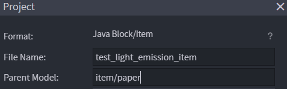<figcaption></figcaption></figure>

创建模型，例如按本例将纹理挤出成立体模型。

<figure>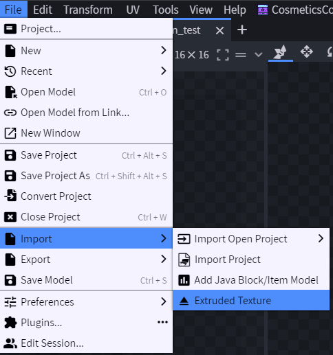<figcaption></figcaption></figure>

将模型调整到中心位置。

<figure>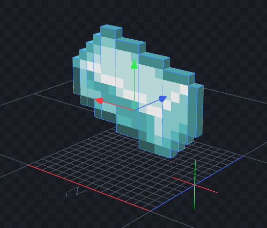<figcaption></figcaption></figure>

按 `CTRL+A` 选择全部立方体，右键设置需要的发光等级。

<figure>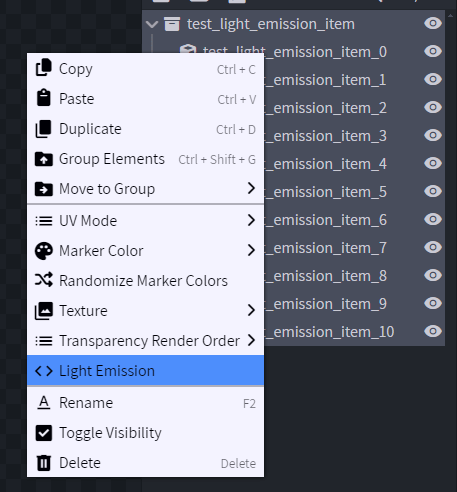<figcaption></figcaption></figure>

保存文件：`contents/test/models/block/test_light_emission_item.json`。

创建配置。

**旧方法**

```yaml
info:
  namespace: test
items:
  test_light_emission_item:
    name: test_light_emission_item
    resource:
      material: PAPER
      generate: false
      model_path: item/test_light_emission_item
```

**新的现代方法（1.21.4+）**

```yaml
info:
  namespace: test
items:
  test_light_emission_item:
    name: test_light_emission_item
    graphics:
      model: item/test_light_emission_item
```

<figure>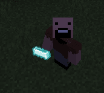<figcaption></figcaption></figure>

## 方块

如果只想让方块的一部分发光，而非整个方块，必须使用 `REAL_TRANSPARENT` 方块类型。

原因是游戏不支持 `REAL` 方块的透明度。

若不使用 `REAL_TRANSPARENT`，可创建只有一层的方块，让整个图层发光。

创建纹理。

<figure>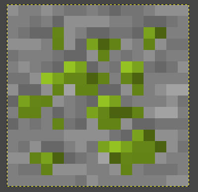<figcaption></figcaption></figure>

将发光层和底层分离成两张图片。

`contents/test/textures/block/test_light_emission.png`

<figure>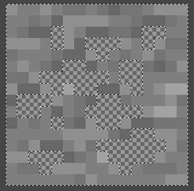<figcaption></figcaption></figure>

`contents/test/textures/block/test_light_emission2.png`

<figure>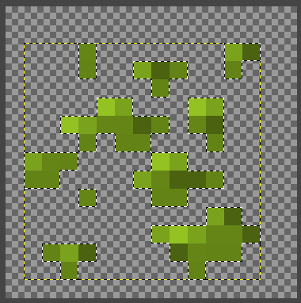<figcaption></figcaption></figure>

在 **Blockbench** 中创建新的 `Java Block/Item` 模型。

<figure>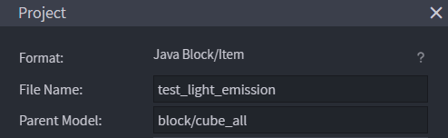<figcaption></figcaption></figure>

创建两个立方体，分别作为底层和发光层。

把两张纹理分别拖放到对应立方体上。

右键发光层，设置需要的发光等级。

<div><figure>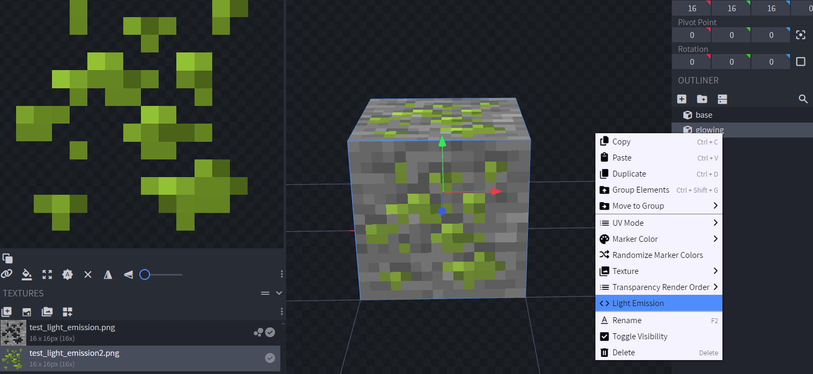<figcaption></figcaption></figure></div>

保存文件：`contents/test/models/block/test_light_emission.json`。

创建配置。

**旧方法**

```yaml
info:
  namespace: test
items:
  test_light_emission:
    name: test_light_emission
    resource:
      material: PAPER
      generate: false
      model_path: block/test_light_emission
    behaviours:
      block:
        placed_model:
          type: REAL_NOTE
          hardness: 1

```

**新的现代方法（1.21.4+）**

```yaml
info:
  namespace: test
items:
  test_light_emission:
    name: test_light_emission
    graphics:
      model: block/test_light_emission
    behaviours:
      block:
        placed_model:
          type: REAL_TRANSPARENT
          hardness: 1

```

<figure>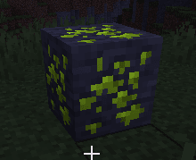<figcaption></figcaption></figure>
