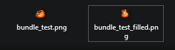
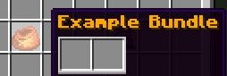

# 收纳袋

## 配置

```yaml
items:
  example_bundle:
    display_name: "&6&lExample Bundle"
    permission: example_bundle
    resource:
      material: BUNDLE
      generate: true
      textures:
      - item/bundle_test.png
```

<div align="left"></div>

需要额外创建带 `_filled` 后缀的文件，本例为 `bundle_test_filled.png`。

## 效果


