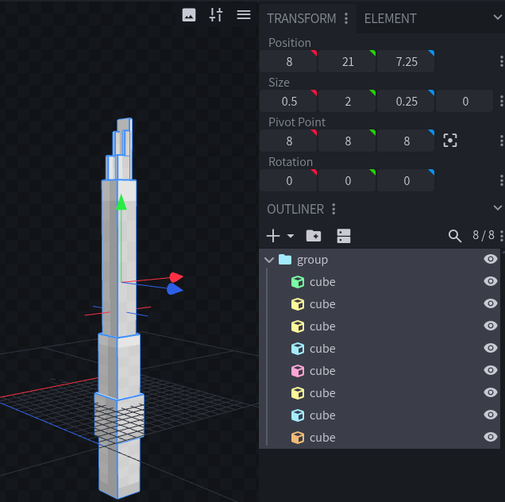
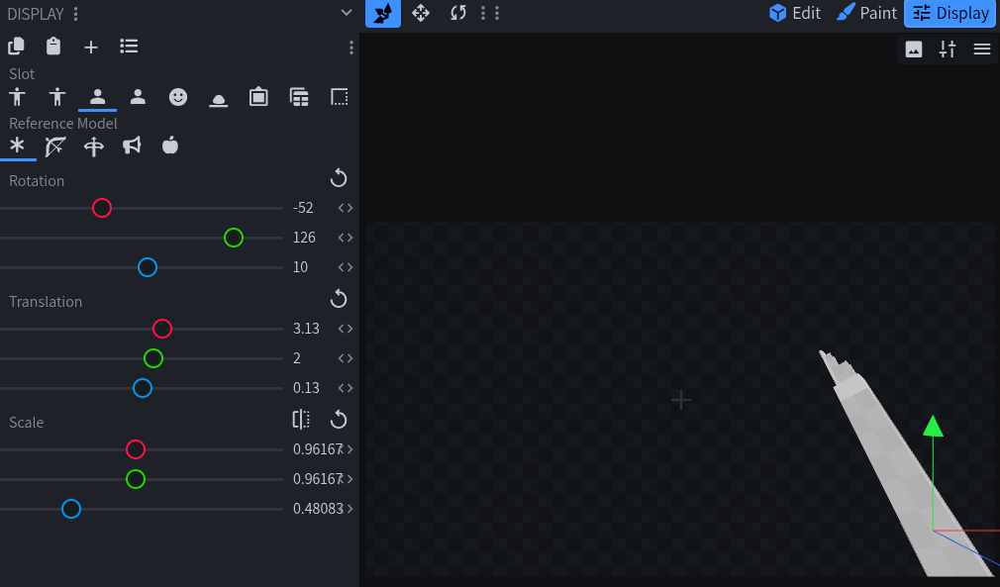

# 长矛
需要 ItemsAdder 4.0.18-beta-16 或更高版本。

以下材质支持自定义长矛外观：

- `WOODEN_SPEAR`
- `STONE_SPEAR`
- `COPPER_SPEAR`
- `IRON_SPEAR`
- `GOLDEN_SPEAR`
- `DIAMOND_SPEAR`
- `NETHERITE_SPEAR`

## 长矛模型

长矛有两种模型状态：

- `normal`：不在玩家手中时使用的默认模型。
- `in_hand`：玩家手持长矛时显示的模型。

`normal` 为必填项；省略 `in_hand` 时，两种状态都会使用 `normal`。

## 使用自定义模型

``` yaml
info:
  namespace: my_spears

items:
  ruby_spear:
    name: Ruby Spear
    material: DIAMOND_SPEAR
    graphics:
      models:
        normal: item/ruby_spear
        in_hand: item/ruby_spear_in_hand
```

将模型文件放在：

``` text
contents/my_spears/models/item/ruby_spear.json
contents/my_spears/models/item/ruby_spear_in_hand.json
```

需要 3D 模型或自定义显示变换时，请使用自定义模型。

### 在 Blockbench 中创建 3D 长矛

打开 Blockbench，创建或打开 **Java Block/Item** 模型。

#### 1. 竖直制作长矛

- 让长矛竖直排列。
- 矛柄向下，矛尖向上。
- 将矛杆放在工作区中央。
- 长矛可以超出普通的 `0` 到 `16` 范围，不必压缩模型来适应边界。

#### 2. 将长矛移到中心

可把工作区中央的 `[8, 8, 8]` 想象为转轴。Minecraft 会围绕此点握持和旋转整根长矛；`[0, 0, 0]` 只是一个角点。

在 **Outliner** 中选择全部立方体，使用 **Move** 工具移动整根长矛，让模型中心位于 `[8, 8, 8]` 附近。保持全选，避免改变形状。

确认矛杆仍然竖直、矛尖朝上。ItemsAdder 会改变手持显示方式，但不会替你调整立方体位置。



若模型围绕 `[0, 0, 0]` 或远离 `[8, 8, 8]` 制作，静止手持可能正常，但切换动画时可能从屏幕上飞过。

#### 3. 设置手持视图

只有需要实际倾斜的部件（例如刀刃或装饰）才应单独旋转立方体。

整根长矛的朝向请在 Blockbench **Display** 页签中设置为：

| Blockbench 预览 | 旋转 |
| --- | --- |
| 第一人称右手 | `[-20, 90, 10]` |
| 第一人称左手 | `[-20, -90, -10]` |
| 第三人称右手 | `[5, 270, 5]` |
| 第三人称左手 | `[5, -270, -5]` |



之后只调整预览中的位移和缩放。

<details>

<summary>精确尺寸（可选）</summary>

- 矛杆中心保持在 `X = 8`、`Z = 8`；整根模型以 `Y = 8` 为中心，矛尖朝 `+Y`。

长度为 `L` 时：

- Y 最小值 = `8 - L / 2`
- Y 最大值 = `8 + L / 2`

长度示例：

| 长度 | Y 最小值 | Y 最大值 |
| --- | --- | --- |
| 16 单位长矛 | `0` | `16` |
| 24 单位长矛 | `-4` | `20` |
| 32 单位长矛 | `-8` | `24` |

矛杆宽度为 `W` 时：

- X 最小值 = `8 - W / 2`
- X 最大值 = `8 + W / 2`
- Z 最小值 = `8 - W / 2`
- Z 最大值 = `8 + W / 2`

32 单位尺寸示例：

| 部件 | From | To |
| --- | --- | --- |
| 矛杆 | `[7.5, -8, 7.5]` | `[8.5, 20, 8.5]` |
| 矛头边界框 | `[6.5, 20, 6.5]` | `[9.5, 24, 9.5]` |

| 居中步骤（X/Y/Z） | X | Y | Z |
| --- | --- | --- | --- |
| 移动前边界 | `-0.5..2.5` | `0..32` | `-0.5..2.5` |
| 模型中心 | `1` | `16` | `1` |
| 移动量 | `+7` | `-8` | `+7` |
| 移动后边界 | `6.5..9.5` | `-8..24` | `6.5..9.5` |
| 新中心 | `8` | `8` | `8` |

整根长矛的居中偏移量：

- offsetX = `8 - (minimum X + maximum X) / 2`
- offsetY = `8 - (minimum Y + maximum Y) / 2`
- offsetZ = `8 - (minimum Z + maximum Z) / 2`

重新居中时，对全部选中立方体的 `From` 和 `To` 应用相同偏移量。

</details>

## 仅使用纹理

ItemsAdder 可以根据纹理自动生成长矛的两个模型。

``` yaml
info:
  namespace: my_spears

items:
  ruby_spear:
    name: Ruby Spear
    material: DIAMOND_SPEAR
    graphics:
      textures:
        normal: item/ruby_spear
        in_hand: item/ruby_spear_in_hand
```

将纹理放在：

``` text
contents/my_spears/textures/item/ruby_spear.png
contents/my_spears/textures/item/ruby_spear_in_hand.png
```

生成的 `in_hand` 模型会自动使用正确的原版长矛显示变换。

### 使用一张纹理

两个状态可以使用同一张纹理：

``` yaml
graphics:
  texture: item/ruby_spear
```

ItemsAdder 会分别生成 `normal` 与 `in_hand` 模型，二者使用指定的同一纹理。

## 自定义图标

用 `icon` 设置独立的背包纹理：

``` yaml
graphics:
  icon: item/ruby_spear_icon
  textures:
    normal: item/ruby_spear
    in_hand: item/ruby_spear_in_hand
```

放在以下位置：

``` text
contents/my_spears/textures/item/ruby_spear_icon.png
```

图标用于 GUI、地面、物品展示实体和置物架。

## 测试

重载 ItemsAdder 并重新生成资源包：

``` text
/iareload
```

获取物品：

``` text
/iaget my_spears:ruby_spear
```
