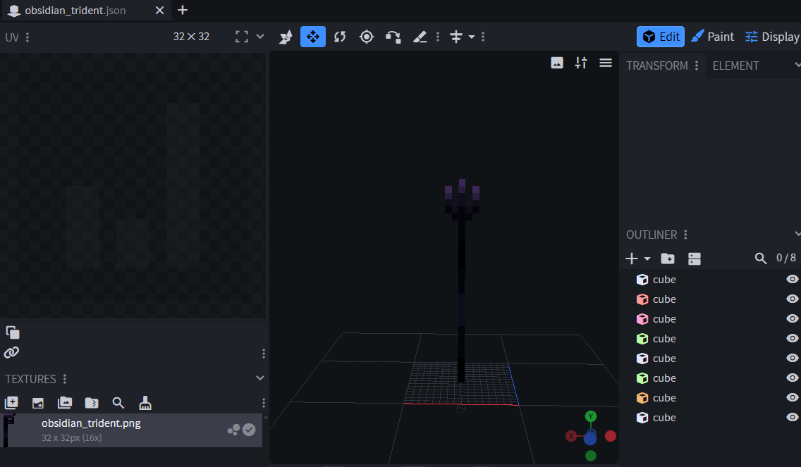
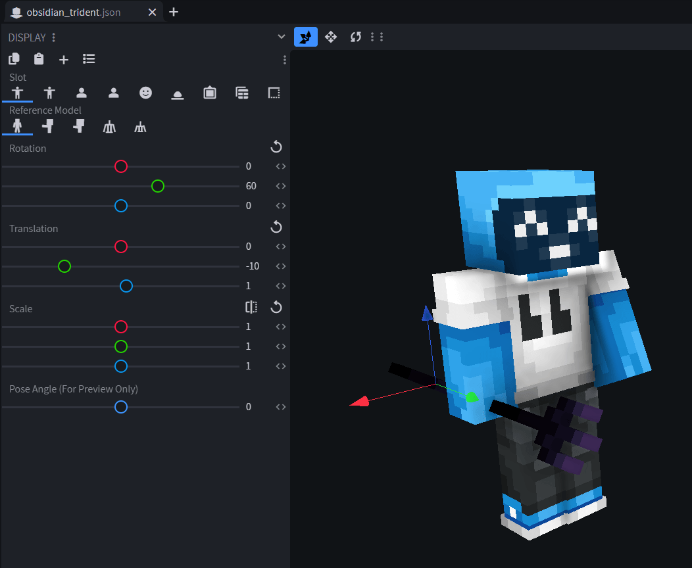
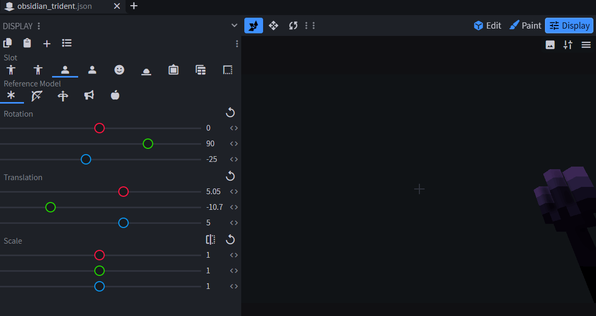
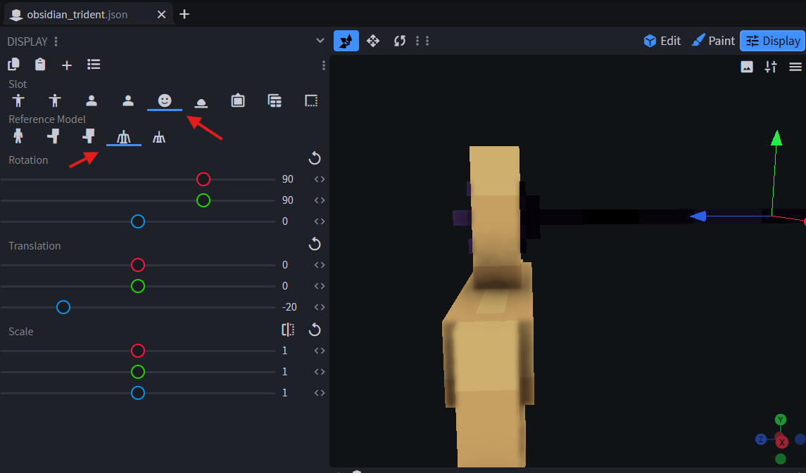

# 三叉戟

自 ItemsAdder 4.0.11 起可用。

需要 Minecraft 1.21.4+ 客户端，服务端版本不影响这一要求。

## 示例物品：`obsidian_trident`

普通手持时使用 `normal` 模型；玩家蓄力投掷时使用 `throwing` 模型。模型路径相对于 `contents/tridents/models/`，不包含 `.json` 扩展名。

```yaml
info:
  namespace: tridents
items:
  obsidian_trident:
    name: <aqua>Obsidian Trident
    material: TRIDENT
    graphics:
      icon: item/obsidian_trident_icon
      models: 
        normal: item/obsidian_trident
        throwing: item/obsidian_trident_throwing
```

### 创建普通模型

手动或通过 Blockbench 创建 `contents/tridents/models/item/obsidian_trident.json`。

<figure><figcaption>Blockbench 中的三叉戟示例模型。</figcaption></figure>

#### 设置手持物品变换

在 Blockbench **Display** 页签中调整三叉戟的第三人称视图位置。

<figure><figcaption>第三人称变换预览。</figcaption></figure>

然后配置第一人称视图。

<figure><figcaption>第一人称变换预览。</figcaption></figure>

#### 设置头部变换

头部变换决定模型装备在头盔槽位时的位置。

<figure><figcaption>Blockbench 中选中的头部变换及参考模型。</figcaption></figure>

普通模型的完整 `display` 段如下：

```json
{
  "display": {
    "thirdperson_righthand": {
      "rotation": [0, 60, 0],
      "translation": [0, -10, 1]
    },
    "thirdperson_lefthand": {
      "rotation": [0, 60, 0],
      "translation": [0, -8, 1]
    },
    "firstperson_righthand": {
      "rotation": [0, 90, -25],
      "translation": [5.05, -10.7, 5]
    },
    "firstperson_lefthand": {
      "rotation": [0, 90, -25],
      "translation": [6.25, -11, 3.5]
    },
    "head": {
      "rotation": [90, 90, 0],
      "translation": [0, 0, -20]
    }
  }
}
```

### 创建投掷模型

按住使用键蓄力投掷时显示此模型。创建 `contents/tridents/models/item/obsidian_trident_throwing.json`。

它可以与普通模型完全不同。如果几何形状相同、仅手持旋转不同，可继承普通模型，只覆盖所需显示变换：

```json
{
  "parent": "tridents:item/obsidian_trident",
  "display": {
    "thirdperson_righthand": {
      "rotation": [0, 90, -180],
      "translation": [0, 11, 1]
    }
  }
}
```

Minecraft 会对投掷三叉戟时的第一人称视图应用硬编码旋转和位移。请配置投掷模型的第三人称变换，不要通过修改第一人称变换来补偿。

## 背包 2D 图标

可以为背包中的物品设置 2D 图标。

[2d-icon.md](item-properties/2d-icon.md)

## 完成


## 示例内容包

[示例内容包](https://github.com/bruhhhwarrior/tridents/releases)
