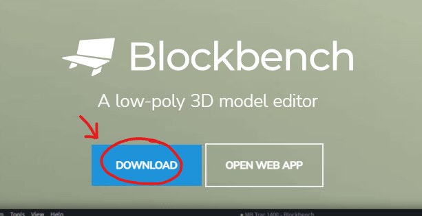
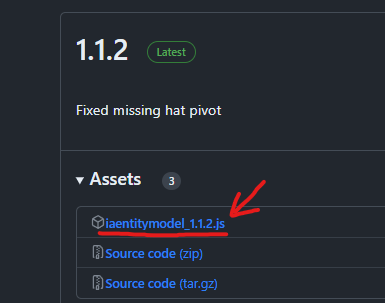
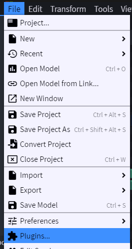
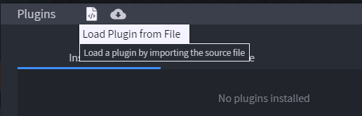
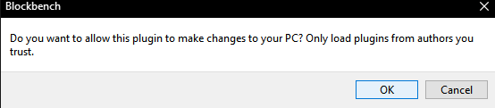

# 玩家表情动作

## 表情与动作

表情动作通过特定的玩家动画表达情绪或动作。\
它们与游戏融为一体，看起来如同官方更新的内容。


非常感谢 **Misieur**（**Thomas**）提供想法，帮助实现此新方法 🩷

```yaml
emotes:
  1_21_4_plus_modern_method: true
```

#### 主要功能

* 用于为 Minecraft 玩家模型制作动画的 [Blockbench](https://www.blockbench.net/) 扩展
* 完全异步，不会降低 TPS
* 针对大型服务器优化
* 在动画中播放声音和粒子
* 显示玩家手持物品和头盔
* 不覆盖任何原版着色器
* 兼容光影模组（Optifine、Iris 等）
* 支持纤细手臂
* 不影响已放置的玩家头颅

#### 限制

* 需要 Minecraft 1.21.4 或更高版本
* 表情动作问题的更多信息见[这里](../faq/emotes-issues.md)

```yaml
emotes:
  legacy_shaders: true
  1_21_5_to_1_21_9_shaders: true
```

#### 主要功能

* 用于为 Minecraft 玩家模型制作动画的 [Blockbench](https://www.blockbench.net/) 扩展
* 完全异步，不会降低 TPS
* 针对大型服务器优化
* 在动画中播放声音和粒子
* 显示玩家手持物品和头盔

#### 限制

* 不显示玩家盔甲装备，只显示主手、副手和头盔。
* 仅适用于 1.17 至 1.21.3 客户端
* 表情动作问题的更多信息见[这里](../faq/emotes-issues.md)

## 安装 Blockbench 扩展

**继续之前：**

* 确认使用 **Blockbench 4.7.4** 或**更高版本**
* 确认使用最新版 ItemsAdder 和最新版 ItemsAdder Blockbench 扩展

[下载 Blockbench](https://www.blockbench.net/)（不要使用网页版）。



\
[下载](https://github.com/LoneDev6/itemsadder-entity/releases)扩展文件。

<figure><figcaption></figcaption></figure>

打开 **Blockbench**，点击 File -> Plugins。



点击从文件加载插件的图标，然后选择 `iaentitymodel.js` 文件。



点击 OK



## 启用表情动作

打开 ItemsAdder 的 `config.yml`，启用这两个选项，然后执行命令 `/iazip`。

```yaml
entities:
  custom-entitites:
    enabled: true
    emotes: true
```
