# 动画

## 打开动画编辑器

新建“`ItemsAdder Entity Model`”。\
可以创建任意数量的动画文件。

<figure>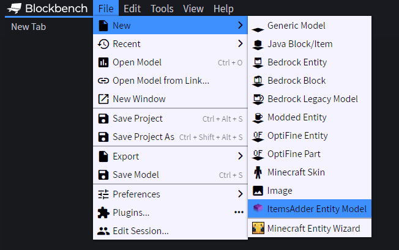<figcaption></figcaption></figure>

选择创建包含示例的表情动作文件，或空白文件。

<figure>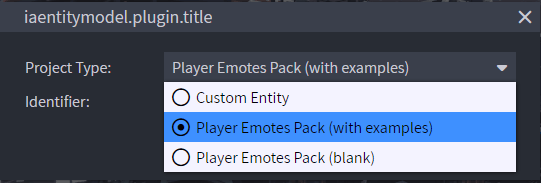<figcaption></figcaption></figure>

为表情动作包命名。

<figure>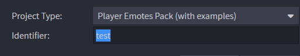<figcaption></figcaption></figure>

左侧会显示许多示例动画。

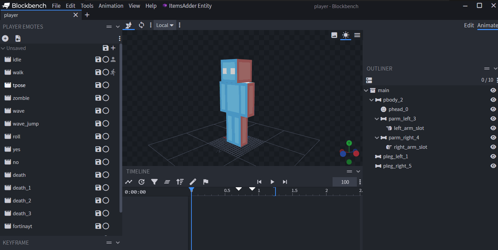

删除不需要的表情动作，编辑或重命名要使用的动作。\
这些示例仅用作新表情动作的基础，供学习参考。

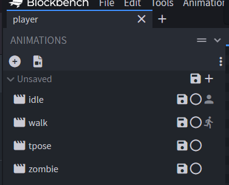

像制作普通 Blockbench 模型动画一样，为模型制作动画。\
YouTube 上有许多教程。

完成后，将 `.iaentitymodel` 工程文件保存到此文件夹（将 `my_emotes` 改为你的命名空间，此处仅为示例）：\
`ItemsAdder/contents/my_emotes/`

<figure>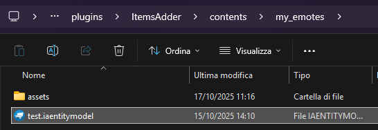<figcaption></figcaption></figure>

继续按教程操作，将表情动作导出到 ItemsAdder。

### 将更改应用到 ItemsAdder

点击 **ItemsAdder** 标签页，再点击 **Export**。

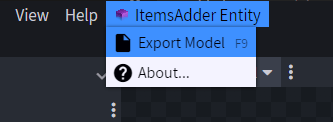

应当看到成功提示。

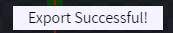

如果表情动作中没有添加自定义模型，就<mark style="color:green;">无需</mark>执行 `/iazip`！\
使用命令 `/iareload`，在游戏中加载新动画。

## 播放动画

使用表情动作命令：`/iaemote <emote> [player]` 或 `/emote <emote> [player]`

## 表情动作权限

使用 `/iaemote` 命令：`ia.user.iaemote`

使用某个表情动作：`ia.user.iaemote.use.<emote>`\
示例：`ia.user.iaemote.use.yes`

### 权限的更多信息

[permissions.md](../../plugin-usage/plugin-configuration/permissions.md)

### 部分示例展示

### 可在这里下载示例工程：

可以在表情动作中添加自定义模型，例如物品、怪物、家具和动态效果。

### **重要**

* 不要删除任何内置玩家骨骼。
* 不要调整内置玩家骨骼的大小，否则在游戏中不会生效。
* 只在动画视图中编辑内置玩家骨骼（旋转、移动）。
* 将内置玩家骨骼缩放为 `0,0,0` 可隐藏它们；设为 `1,1,1` 可重新显示。

### 不同类型的表情动作

* `.player_advanced_animations` 文件格式现在用于标识包含额外自定义模型的玩家动画。
* `.player_animations` 表示不添加自定义模型、直接加载到默认玩家模型的动画。

在 **Blockbench** 扩展设置中设置此选项，即可选择类型。

[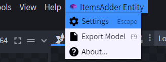](https://user-images.githubusercontent.com/27242001/244145963-c9ca9a77-bb79-4804-92e4-8708eac41517.png)

<figure>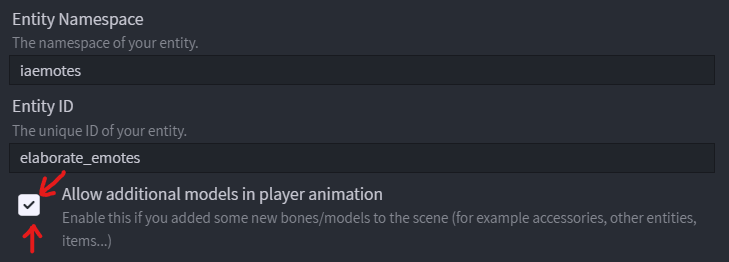<figcaption></figcaption></figure>

### 向场景导入元素

可以将任意 `.bbmodel` 导入场景，用于动画。\
也可以导入挤出纹理，动态显示物品。

<figure>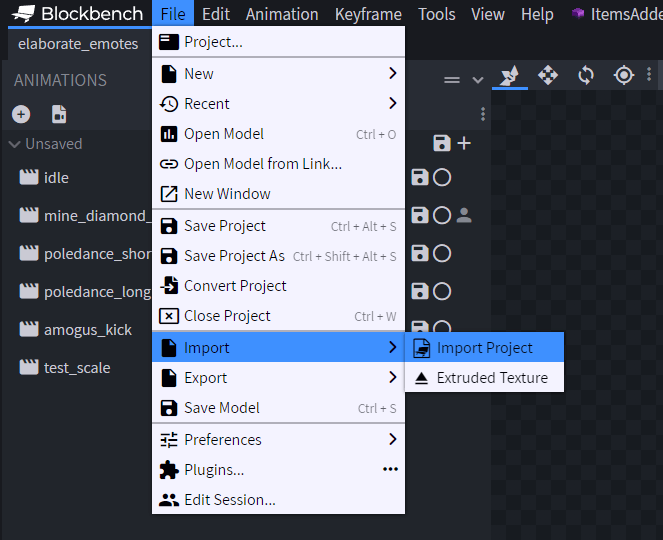<figcaption></figcaption></figure>

### 在 `.iaentitymodel` 表情文件的其他游戏动画中隐藏未使用元素

1. 选择动画
2. 选择需要在此动画中隐藏的元素
3. 通过时间轴移动到动画第一帧
4. 创建缩放关键帧，确认位于第一个关键帧
5. 将缩放设为 0

此模型现在不会在该动画中显示。\
也可以在动画中途隐藏或显示它；方法相同，只需将缩放设为 1 即可显示。

<figure>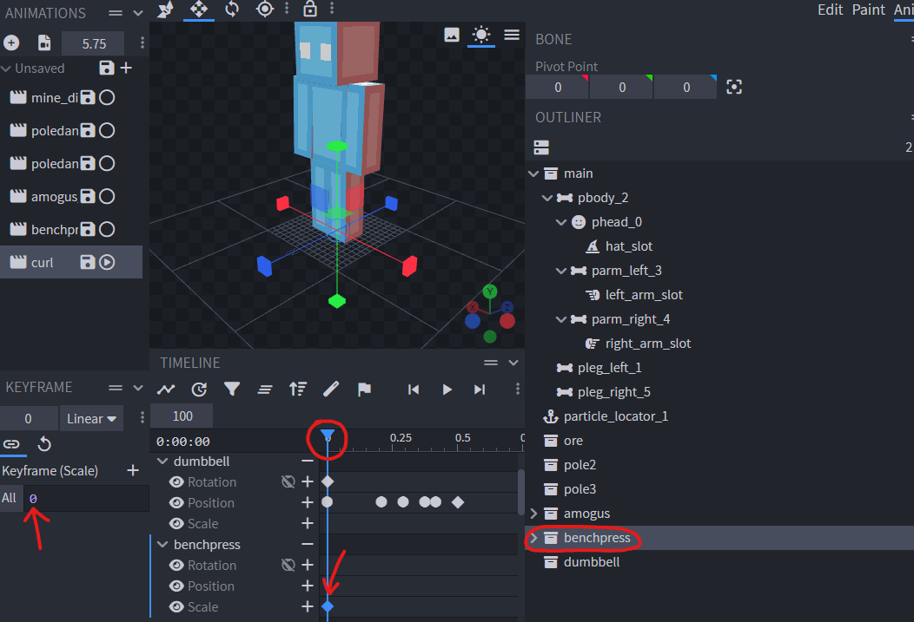<figcaption></figcaption></figure>

## 锁定玩家移动

可按动画分别指定：播放时玩家是否可以移动。

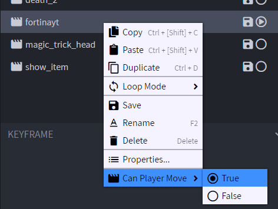

## 循环动画

可以创建依次播放 `start` -> `loop` -> `end` 子动画的动画。\
这可用于制作复杂的循环动画，例如睡眠动作：玩家躺下后保持该状态，直到按下 SHIFT。

### 步骤 1

创建动画，本例为死亡动画。

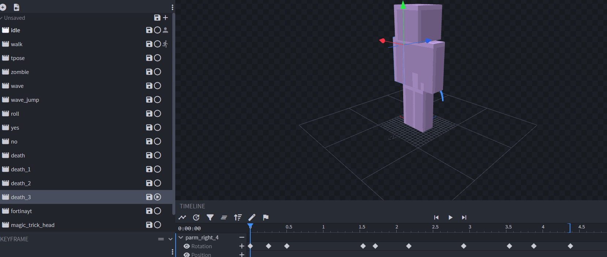

右键点击，将其标记为 `Loop`。

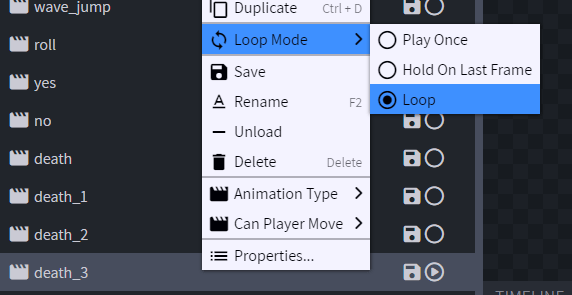

### 步骤 2

将播放光标移到开始循环的位置，本例为玩家落地的那一帧。

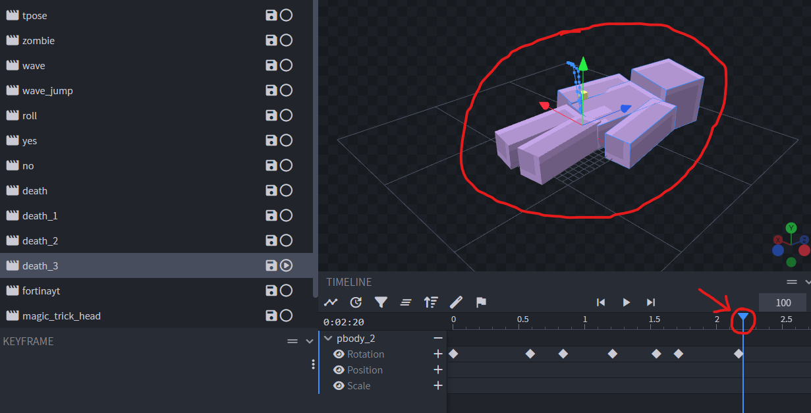

### 步骤 3

点击 `Add Loop Start/End marker` 图标，添加 `start loop` 标记。

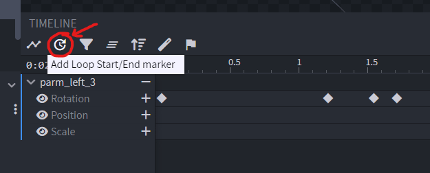

将动画光标移到停止循环的位置，再次点击 `Add Loop Start/End marker` 图标。

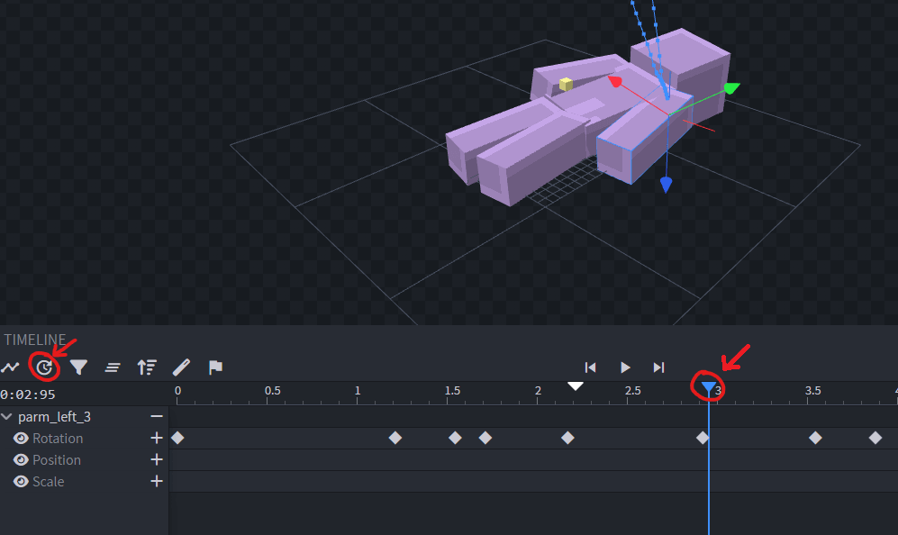

结果如下：

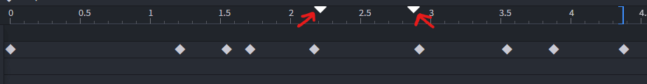
