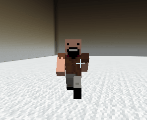
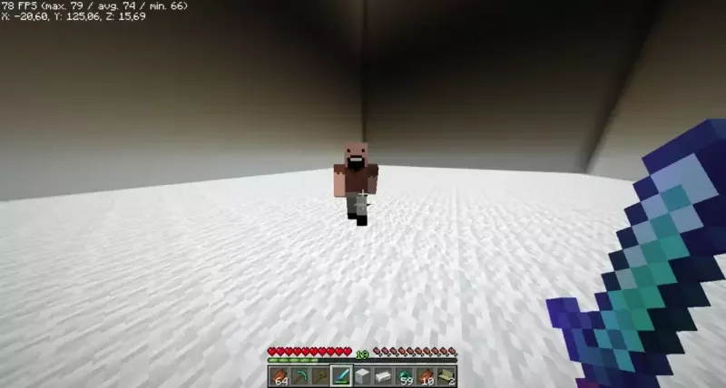

# Mythicmobs

## 为 MythicMobs 生物更换皮肤

可以为任意 MythicMobs 生物使用自定义玩家皮肤。

此插件本身不依赖 MythicMobs，但部分服务器可能需要用它创建自定义首领等内容。

### 更换模型

在以下路径创建 MythicMobs 生物配置文件：`plugins/MythicMobs/entities/custom_player.yml`\
`\`（文件名可自行决定）。

不要将类型设为 `PLAYER`，否则会造成头部和身体旋转问题。

```yaml
custom_player:
  Type: ZOMBIE
  Display: '&aCustom Player'
  Health: 10
  Damage: 2
  Options:
    MovementSpeed: 0
    Silent: true
  Skills:
  - customentity{playerskin=https://minesk.in/5f1e7ff6409e428bb500cc9315bf7ffb} @self ~onSpawn
```

本例将 MythicMobs 生物的皮肤更换为 **Notch** 的皮肤。



### 自定义皮肤

[custom-skin.md](../../entities/custom-skin.md)

### 技能

* `customentity{playerskin=SKIN}`：更换玩家皮肤
* `customentity{idle=ANIMATION}`：更改待机动画
* `customentity{walk=ANIMATION}`：更改行走动画
* `customentity{attack=ANIMATION}`：更改攻击动画
* `customentity{death=ANIMATION}`：更改死亡动画
* `customentity{play=ANIMATION}`：立即播放动画
* `customentity{stop=ANIMATION}`：停止当前动画

### 完成


