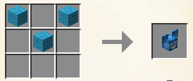
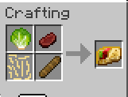
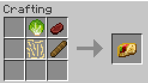
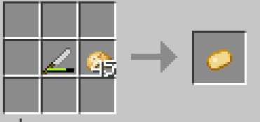
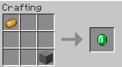
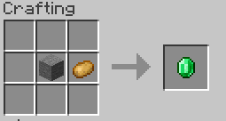

# 合成

如需标签支持或其他功能，可使用 [ItemsAdderAdditions](https://itemsadderadditions.com/en/docs/recipes/crafting)。

创建配方时，需要在某个 `.yml` 文件中添加特殊配置节。\
可以将此配置节添加到任意 `.yml` 文件中，方便整理配方。

## 3x3 配方



```yaml
info:
  namespace: myitems
recipes:
  crafting_table:
    deadmau5_hat:
      permission: myitems.deadmau5_hat
      enabled: true
      pattern:
      - BXB
      - XBX
      - XXX
      ingredients:
        B: LIGHT_BLUE_WOOL
      result:
        item: myitems:deadmau5_hat
        amount: 1
```

如你所见，我在 .yml 文件中创建了配方部分，这个部分可以包含每种类型的配方。\
本例创建了名为 `deadmau5_hat` 的 `crafting_table` 配方。

## 2x2 配方



<figure><figcaption></figcaption></figure>

### 方法 1

```yaml
taco:
  permission: itemsadder.taco
  enabled: true
  pattern:
  - XSC
  - XPB
  ingredients:
    B: itemsadder:baguette
    C: itemsadder:sliced_roast_beef
    P: itemsadder:potato_sticks
    S: itemsadder:lettuce
```

### 方法 2

```yaml
taco:
  permission: itemsadder.taco
  enabled: true
  pattern:
  - SC
  - PB
  ingredients:
    B: itemsadder:baguette
    C: itemsadder:sliced_roast_beef
    P: itemsadder:potato_sticks
    S: itemsadder:lettuce
```

## 多种模式

你可以为每个配方创建**多种模式**，只要保证每个属性以 `pattern` **开头**。例如本例 `pattern_2`。

```yaml
turquoise_sword:
  permission: itemsadder.turquoise_sword
  enabled: true
  pattern:
  - XRX
  - XRX
  - XSX
  pattern_2:
  - RXX
  - XXR
  - XSX
  ingredients:
    R: itemsadder:turquoise
    S: STICK
  result:
    item: itemsadder:turquoise_sword
    amount: 1
```

## 特殊功能

```yaml
    peeled_potato:
      permission: itemsadder.peeled_potato
      enabled: true
      pattern:
      - XXX
      - XKP
      - XXX
      ingredients:
        K: itemsadder:knife
        P: POTATO
      result:
        item: itemsadder:peeled_potato
        amount: 1
      return_items:
        decrement_durability:
          knife:
            item: knife
            amount: 1
        play_sound:
          name: itemsadder:item.knife.use
          volume: 1
          pitch: 1
```

例如，这是 `peeled_potato` 配方。这是一个特殊的配方，它使用刀作为合成的材料（还有土豆），并在玩家制作一个去皮土豆时减少其耐久度，而不会使其消失。



如您所见，您还可以使用 `play_sound` 播放声音。

## 无序配方

```yaml
shapeless_emerald_example:
  enabled: true
  shapeless: true
  ingredients:
    A: POTATO
    B: STONE
  result:
    item: EMERALD
    amount: 1
```

<figure><figcaption></figcaption></figure>

<figure><figcaption></figcaption></figure>

## 材料中的药水类型

使用 `potion_type` 属性，可以要求材料为特定药水类型，例如：

```yaml
info:
  namespace: myitems
recipes:
  crafting_table:
    infested_cobblestone:
      permission: myitems.infested_cobblestone
      enabled: true
      pattern:
        - CCC
        - CAC
        - CCC
      ingredients:
        C: COBBLESTONE
        A:
          item: POTION
          potion_type: minecraft:infested
      result:
        item: INFESTED_COBBLESTONE
        amount: 8
      return_items:
        - item: GLASS_BOTTLE
          amount: 1

```

