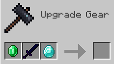

# 锻造

<figure><figcaption></figcaption></figure>

```yaml
info:
  namespace: my_items
recipes:
  smithing:
    my_sword_modified_recipe:
      enabled: true
      permission_suffix: recipes_group_1.my_sword_modified_recipe
      base: my_sword
      addition: DIAMOND
      template: EMERALD
      result:
        item: my_sword_modified
        amount: 1
```

`base`、`addition`、`template` 均为必填，必须指定全部 3 件物品。

## 属性

#### `template`

第一个槽位的物品。

#### `base`

第二个槽位的物品。

#### `addition`

第三个槽位的物品。

#### `result`

产出的物品。

#### `permission_suffix`

此选项定义所需权限。\
它只表示权限的**后缀**。

完整权限格式为：`ia.user.recipe.<permission_suffix>`。

**示例：**\
`ia.user.recipe.recipes_group_1.my_sword_modified_recipe`

**高级用法：**\
可以授予 `ia.user.recipe.recipes_group_1.*`，允许使用该组内的全部配方。
