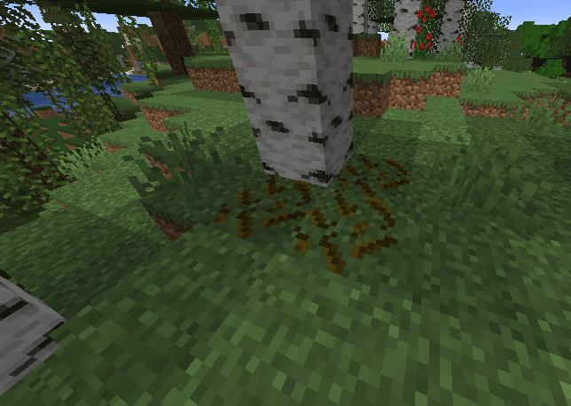
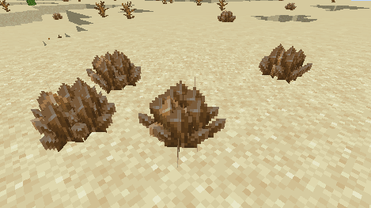
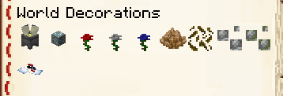

# 地表生成器

## 在世界地表生成装饰

使用 ItemsAdder，您可以在世界各地生成装饰，使您的服务器更加专业和独特。

例如新的蘑菇、小型植物、岩石和装饰物。





## 创建地表生成器

### 创建配置

例如，让我们创建一个将在世界各地生成的玫瑰。

```yaml
info:
  namespace: myitems
surface_decorators:
  rose:
    block: rose
    bottom_blocks:
    - DIRT
    - GRASS_BLOCK
    biomes:
    - PLAINS
    - SUNFLOWER_PLAINS
    - RIVER
    - MOUNTAINS
    - MOUNTAIN_EDGE
    - BIRCH_FOREST
    - BIRCH_FOREST_HILLS
    - TALL_BIRCH_FOREST
    - TALL_BIRCH_HILLS
    worlds:
      - world
    chance: 10
    max_height: 255 
    min_height: 0
    amount: 1
```

本例设置了以下属性：

`block` 是要生成为装饰的 ItemsAdder 方块。

`bottom_blocks` 属性用于决定装饰可以生成的方块类型。

`biomes` 属性用于决定装饰可以生成的有效生物群系。

`worlds` 属性决定装饰可以生成的世界。

`chance` 是每个世界区块中生成装饰的几率。

`max_height` 是装饰可以生成的最大世界高度。

`min_height` 是装饰可以生成的最小世界高度。

`amount` 是一组装饰物生成的方块数量。例如设为 5，即可生成一组 5 个彼此相连的装饰物。

## 创建方块

接着按教程创建方块即可。可以按需使用 `REAL_NOTE`、`REAL_WIRE` `REAL_TRANSPARENT` 和 `REAL` 方块。

[block.md](../blocks.md)

## 示例

你可以在此处下载完整可用的附加包：



