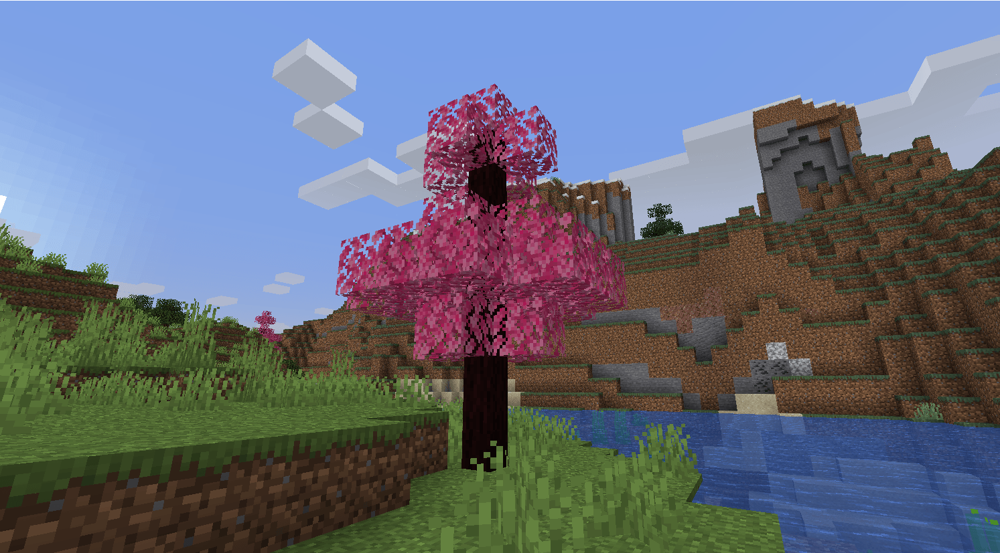

# 树木生成器

## 创建树叶和木块

为了创建自定义树木，你需要为每棵树创建两个方块：树叶和木块。

### 按照本教程创建方块

[block.md](../blocks.md)

例如，按教程创建 2 个方块：`my_leaves`、`my_log`。

```yaml
info:
  namespace: myitems
items:
  my_leaves:
    display_name: "My Leaves"
    permission: myitems.my_leaves
    resource:
      material: PAPER
      generate: true
      textures:
      - block/my_leaves.png
    behaviours:
      block:
        hardness: 0.2
        cancel_drop: true
        placed_model:
          type: REAL_TRANSPARENT
          break_particles: ITEM
  my_log:
    display_name: "My Log"
    permission: myitems.my_log
    resource:
      material: PAPER
      generate: true
      textures:
      - block/my_log/log_top.png
      - block/my_log/log.png
      - block/my_log/log.png
      - block/my_log/log.png
      - block/my_log/log_top.png
      - block/my_log/log.png
    behaviours:
      block:
        hardness: 1.7
        placed_model:
          type: REAL
          break_particles: ITEM
        break_tools_whitelist:
        - _AXE
        - _axe
        - HAND
```

## 创建树苗（可选）

### 树苗物品

```yaml
items:
  orange_tree_sapling:
    display_name: Sapling
    permission: orange_tree_sapling
    resource:
      material: ORANGE_WOOL
      generate: true
      textures:
      - block/orange/sapling.png
    behaviours:
      sapling:
        tree_populator: orange_tree
```

### 自定义树木生成器

```yaml
trees_populators:
  orange_tree:
    worlds:
    - world
    chance: 5.0
    max_height: 100
    min_height: 50
    amount: 3
    iterations: 2
    log: newtrees:orange_tree_log
    leaves: newtrees:orange_tree_leaves
    tree_type: 
    biomes:
    - MOUNTAINS
```

## 在世界中生成树木

先阅读创建树木方块（树叶和木头）的教程。

**末地维度**

建议**不要**在**末地**维度生成树木，因为它有一些**问题**。

**原版树木错误**

有时树木会生成带有原版树叶，这是一个已知问题，我没有解决方案。似乎是Minecraft/Spigot的错误，IA使用的某个事件有时不会触发。

**大树卡顿**

大型树木在生成时可能造成卡顿，请只使用小型树种。

## 使树木随机生成

为了使树木在世界中生成，你需要创建一个`tree_populator`。

```yaml
info:
  namespace: myitems
trees_populators:
  my_tree:
    worlds:
    - world
    bottom_blocks:
    - DIRT
    - GRASS_BLOCK
    - PODZOL
    chance: 40.0
    max_height: 100
    min_height: 50
    amount: 3
    iterations: 2
    tree_type: TREE
    leaves: myitems:my_leaves
    log: myitems:my_log
    biomes:
    - PLAINS
    - SUNFLOWER_PLAINS
    - MOUNTAINS
```

### `worlds`

此属性指定树木可以生成的世界。

### `bottom_block`

此属性指定树木可以生成在哪种方块上。

### `chance`

树木在一个区块中生成的几率。

### `min_height` 和 `max_height`

决定树木生成的高度区间。

### `amount`

每组生成的树木数量。

### `iterations`

如果**几率**匹配，当前区块中需要生成的树木组数。

### `tree_type`

要生成的树木类型。完整列表可以在[这里](https://hub.spigotmc.org/javadocs/spigot/org/bukkit/TreeType.html)找到。\
此属性是可选的，如果不设置，此树木将在每个生物群系中生成。

### `leaves`

用于此树木的树叶方块。

### `log`

用作这棵树的原木的方块。

### `biomes`

树木可以生成的生物群系列表。完整列表可以在[这里](https://hub.spigotmc.org/javadocs/spigot/org/bukkit/block/Biome.html)找到。\
此属性是可选的，如果不设置，此树木将在每个生物群系中生成。

## 示例



