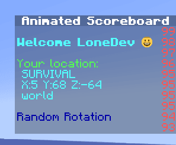

# AnimatedScoreboard

## [点此下载](https://www.spigotmc.org/resources/animatedscoreboard.20848/)

请在寻求帮助前查看插件教程, 我不是该插件的开发人员, 因此这些信息可能会在某个时候过时.

## 计分板中的字体图片

安装 **PlaceholderAPI** 后，你可以在计分板中使用 [font\_images ](../../adding-content/font-images/font-images.md)（表情符号和符号）。

### 示例

`%img_smile%` 的显示效果如下：



## 隐藏计分板背景

通过 ItemsAdder 你可以隐藏计分板背景, 只需如此操作.

(适用于任何支持PlaceholderAPI的计分板插件)

​

<figure><figcaption></figcaption></figure>

​\\

<figure><figcaption></figcaption></figure>

### 如何隐藏背景

你只需要在计分板配置的<mark style="color:yellow;">**每行**</mark>前添加 `%img_offset_-500%` ，<mark style="color:yellow;">即使是空行！</mark>

**警告！**

与 **AnimatedScoreboard** 的下述或类似的属性不兼容！

`<health full=&4 half=&c empty=&f update=5>❤</health>`

`<repeat times=10>|</repeat>`

`<stay ticks=100>&lAnimated Scoreboard</stay>`

<mark style="color:red;">请勿向我寻求帮助</mark>, 我无法修复该问题, 我并非 **AnimatedScoreboard** 的作者.

如果你要使用 `<stay>`，必须将 `%img_offset_-500%` 放在第一个 `>` 后面。\
例如：

`<stay ticks=100>%img_offset_-500%&lAnimated Scoreboard</stay>`

<details>

<summary>&#x3C;--- 点此获取示例YML配置文件</summary>

<p class="code-title"><code>defaultscoreboard.yml</code></p>

```yaml
display:
    title:
      text:
      - "%img_offset_-500%&lA"
      - "%img_offset_-500%&lAn"
      - "%img_offset_-500%&lAni"
      - "%img_offset_-500%&lAnim"
      - "%img_offset_-500%&lAnima"
      - "%img_offset_-500%&lAnimat"
      - "%img_offset_-500%&lAnimate"
      - "%img_offset_-500%&lAnimated"
      - "%img_offset_-500%&lAnimated "
      - "%img_offset_-500%&lAnimated S"
      - "%img_offset_-500%&lAnimated Sc" 
      - "%img_offset_-500%&lAnimated Sco"
      - "%img_offset_-500%&lAnimated Scor"
      - "%img_offset_-500%&lAnimated Score"
      - "%img_offset_-500%&lAnimated Scoreb"
      - "%img_offset_-500%&lAnimated Scorebo"
      - "%img_offset_-500%&lAnimated Scoreboa"
      - "%img_offset_-500%&lAnimated Scoreboar"
      - "%img_offset_-500%&lAnimated Scoreboard"
      - "%img_offset_-500%&c&lAnimated Scoreboard"     
      - "%img_offset_-500%&lAnimated Scoreboard"
      - "%img_offset_-500%&c&lAnimated Scoreboard"
      - "%img_offset_-500%&lAnimated Scoreboard"
      - "%img_offset_-500%&c&lAnimated Scoreboard"
      - "<stay ticks=100>%img_offset_-500%&lAnimated Scoreboard</stay>"
      random: false
      interval: 2
    line-1:
      text:
      - "%img_offset_-500%"
      random: false
      interval: 200
      score: 99   
    line-2:
      text:
      - "%img_offset_-500%&a&lWelcome %player_name%"
      - "%img_offset_-500%&b&lWelcome %player_name%"
      - "%img_offset_-500%&c&lWelcome %player_name%"   
      random: false
      interval: 5
      score: 98
    line-3:
      text:
      - "%img_offset_-500%"
      random: false
      interval: 20
      score: 97
    line-4:
      text:
      - "%img_offset_-500%&aYour gamemode:"
      - "%img_offset_-500%&aYour location:"
      - "%img_offset_-500%&aYour world:"    
      random: false
      interval: 60
      score: 96
    line-5:
      text:
      - "%img_offset_-500% &b%player_gamemode%"
      random: false
      interval: 60
      score: 95
    line-6:
      text:
      - "%img_offset_-500% &bX:%player_x% Y:%player_y% Z:%player_z%"
      random: false
      interval: 1
      score: 95
    line-7:
      text:
      - "%img_offset_-500% &b%player_world%"    
      random: false
      interval: 60
      score: 95
    line-8:
      text:
      - "%img_offset_-500%"
      random: false
      interval: 200
      score: 95
    line-9:
      text:
      - "%img_offset_-500%&1Random Rotation"
      - "%img_offset_-500%&2Random Rotation"
      - "%img_offset_-500%&3Random Rotation"
      - "%img_offset_-500%&4Random Rotation"
      - "%img_offset_-500%&5Random Rotation"
      - "%img_offset_-500%&6Random Rotation"
      - "%img_offset_-500%&7Random Rotation"
      - "%img_offset_-500%&8Random Rotation"
      - "%img_offset_-500%&9Random Rotation"
      - "%img_offset_-500%&aRandom Rotation"
      - "%img_offset_-500%&bRandom Rotation"
      - "%img_offset_-500%&cRandom Rotation"
      - "%img_offset_-500%&dRandom Rotation"
      - "%img_offset_-500%&eRandom Rotation"
      - "%img_offset_-500%&kRandom Rotation" 
      - "%img_offset_-500%&lRandom Rotation" 
      - "%img_offset_-500%&mRandom Rotation" 
      - "%img_offset_-500%&nRandom Rotation"
      - "%img_offset_-500%&oRandom Rotation"
      - "%img_offset_-500%&rRandom Rotation"       
      random: true
      interval: 1
      score: 94
    line-10:
      text:
      - "%img_offset_-500%"       
      random: true
      interval: 1
      score: 93
```


</details>
