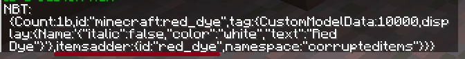

# DeluxeMenu

要在 **DeluxeMenu** 中显示 ItemsAdder 物品，你可以添加此内容至 material 中

```yaml
material: itemsadder-red_dye
```

你需要设置自定义物品的 ID，而非 `red_dye`。

### 如何获得 ID？

* 手持你想使用的物品，运行 `/iatag` 
* 复制 `id` 的名称，例如 `red_dye`
