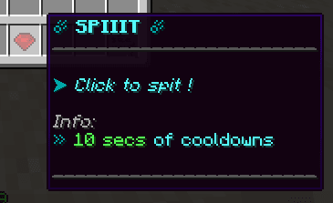

# ExecutableItems

## [此处下载](https://www.spigotmc.org/resources/custom-items-free-executable-items-1-12-1-17.77578/)

## 如何将 ExecutableItem 物品与 ItemsAdder 物品连接

## 创建 ItemsAdder 物品

### 照常创建 .yml 文件，并添加 ItemsAdder 物品的全部属性

本例中，我会将名为 `executableitem_test` 的 **ItemsAdder** 物品与 ExecutableItem 示例文件中的 `spit` 示例物品关联。

```yaml
info:
  namespace: example
items:
  executableitem_test:
    display_name: executableitem_test
    permission: executableitem_test
    executableitem:
      id: Free_Spit
    resource:
      material: IRON_INGOT
      generate: true
      textures:
      - item/executableitem_test.png
    durability:
      max_custom_durability: 1324
```

如你所见，我设置了叫做 \*\*`executableitem`\*\*与 **`id`** 的新属性。\
这些设置用于**关联这两个物品**。

### 获得物品

运行 `/iaget executableitem_test` 以获得目标物品！


