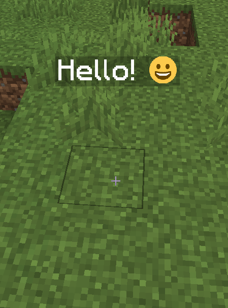
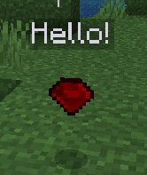

# Holographic Displays

## 如何在全息中使用表情

* 下载 [Holographic Displays](https://dev.bukkit.org/projects/holographic-displays)
* 下载 [PlaceholderAPI](https://www.spigotmc.org/resources/placeholderapi.6245/)
* 下载 [HolographicExtension addon](https://www.spigotmc.org/resources/holographicextension.18461/)

现在，你可以在全息文字中，以及所有支持 **PlaceholderAPI** 的插件中的各处使用 [font\_images ](../../adding-content/font-images/font-images.md)（**表情符号**）。本例使用的是 **Holographic Displays**。\
写法为 `%img_NAME%`，将 NAME 替换为 font\_image 名称。\
如: `%img_smile%`

你可以使用如下示例来创建一个全息：

`/holo create test_itemsadder Hello! %img_smile%`

## 如何添加一个自定义物品掉落物

* 运行 `/iacustommodeldata <item>` （如 `/iacustommodeldata ruby`）
* 复制 `CustomModelData`, 如 `10000`
* 创建一个新的全息，如：`/hd create holo_icon Hello!`
* 添加全息掉落物，并指定 **vanilla type** 与 **CustomModelData**。如：`/hd addline holo_icon ICON: IRON_INGOT {CustomModelData: 10000}`

\`\`
