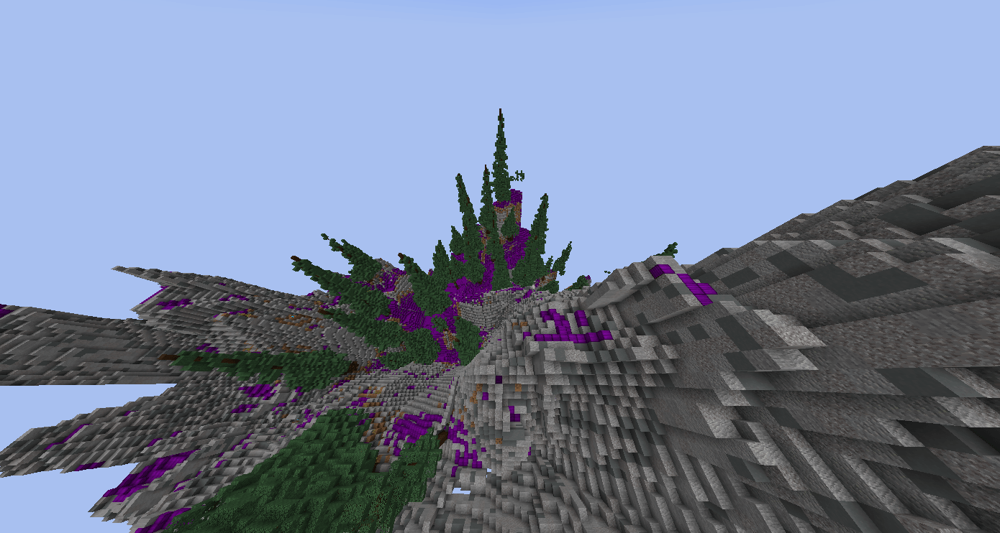
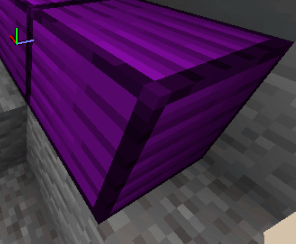

# Iris

## [此处下载](https://www.spigotmc.org/resources/iris-world-gen-custom-biome-colors.84586/)

## 启用兼容

### 步骤 1

安装 [ItemsAdderBlocksInjector](https://www.spigotmc.org/resources/itemsadderblocksinjector.102078/)，<mark style="color:red;">安装后不要移除！</mark>

### 步骤 2

创建你的 Iris 世界（依据插件教程），使用 ItemsAdder 自定义 ID， 就像原版方块一样。

\
例如打开 `overworld` 中的 `plugins\Iris\packs\overworld\biomes\mountain\mountain.json`

然后编辑 layers 部分中的设置以添加自定义方块，本例为自定义的 **Amethyst Block**：

```json
{
  "layers": [
    {
      "minHeight": 1,
      "maxPerChunk": 21,
      "maxHeight": 80,
      "minPerChunk": 7,
      "minSize": 3,
      "maxSize": 7,
      "palette": [{ "block": "iasurvival:cassiterite_ore" }],
      "varience": 7
    }
  ]
}
```

这会得到与此类似的结果:





## 兼容问题

* FastAsyncWorldEdit 会停止工作，我什么都做不到。
* WorldEdit 的 `//undo` 与 `//copy` 不会对 `Iris` 放置的自定义方块生效，他们会变回 `NOTE_BLOCK` （或 `mushroom`, `TRIPWIRE`, `CHORUS_PLANT`）
