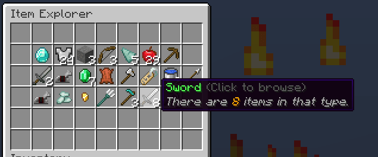
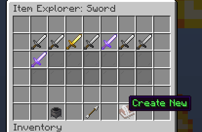
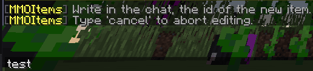
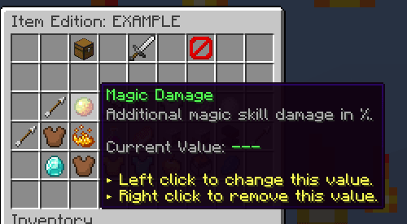
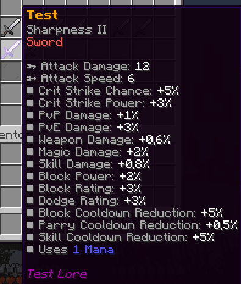
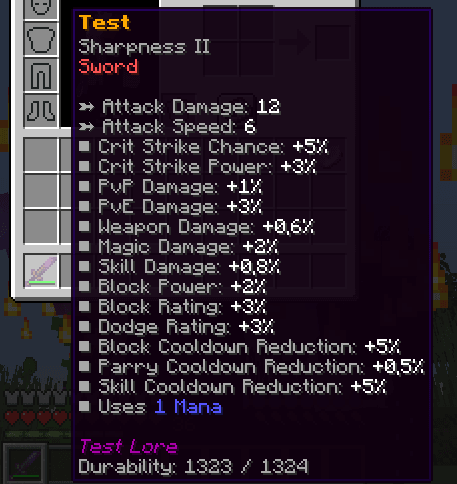

# MMOItems

在[此处](https://www.spigotmc.org/resources/mmoitems-premium.39267/)下载 **MMOItems**

### 你可以在此处下载教程中的示例


## 已知限制


## 将MMOItem与ItemsAdder物品连接

### 使用命令 /mmoitems browse



### 创建一个新的 MMOItem





### 添加你想要的所有属性,如魔法伤害等



### 在 /mmoitems browse 中预览 MMOItem



### 照常创建 .yml 文件，并添加 ItemsAdder 物品的全部属性

`ItemsAdder/contents/mmoitems_example/configs/example.yml`

如你所见, 我设置了一个叫做 **`mmoitem`** 的新属性, 同时还有 **`type`** 与 **`id`** 。\
这些设置用于**关联这两个物品**。

```yaml
info:
  namespace: mmoitems_example
items:
  test:
    display_name: ""
    permission: example_item
    mmoitem:
      type: SWORD
      id: TEST
    resource:
      material: DIAMOND_SWORD
      generate: true
      textures:
      - item/test.png
    durability:
      max_custom_durability: 1324
```

### 正常创建你的.png纹理

`ItemsAdder/contents/mmoitems_example/resourcepack/mmoitems_example/textures/item/test.png`

### 获得物品

使用指令`/iaget mmoitems_example:test`来得到成品



