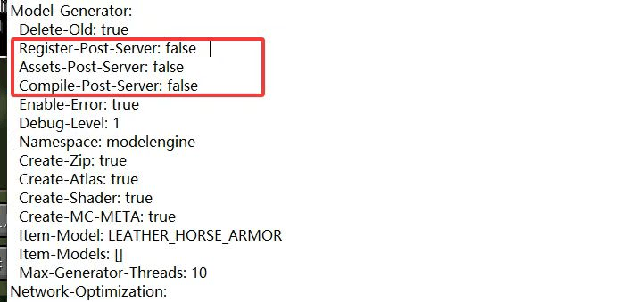

# ModelEngine

## [此处下载](https://www.spigotmc.org/resources/conxeptworks-model-engine%E2%80%94ultimate-entity-model-manager-1-14-1-17-1.79477/)

## 如何添加兼容？

* 将所有生物模型和配置添加到 **ModelEngine** 插件文件夹中（更多信息请参阅 **ModelEngine** 教程）
* 打开 **ItemsAdder** 的 `config.yml`，并设置以下内容：

``` yaml
    merge_other_plugins_resourcepacks_folders:
      - "ModelEngine/resource pack"
```

* 运行 `/meg reload` 以生成 **ModelEngine** 资源包
* `/iazip`（如有需要，请参考[托管教程](../../plugin-usage/plugin-configuration/resourcepack-hosting.md)）。

### ItemsAdder 与 ModelEngine 的不同

[modelengine-vs-itemsadder.md](../../faq/modelengine-vs-itemsadder.md)

## `NoSuchFileException` 问题

```
[ItemsAdder] Plugin ItemsAdder v4.0.15 generated an exception while executing task 9132
java.io.UncheckedIOException: java.nio.file.NoSuchFileException: /home/container/plugins/ModelEngine/resource pack/assets/minecraft
        at org.apache.commons.io.function.Uncheck.wrap(Uncheck.java:339) ~[commons-io-2.17.0.jar:2.17.0]
```

打开 **ModelEngine** 的 `config.yml` 文件，将高亮选项设为 `false`。\
这会强制 **ModelEngine** 在服务器启动早期加载资源，而不是等待服务器完全初始化后再加载。

根本原因在于插件加载顺序：ItemsAdder 在 ModelEngine 完成资源加载前就尝试访问其模型文件，因此无法访问这些文件。

<div><figure><figcaption></figcaption></figure></div>
