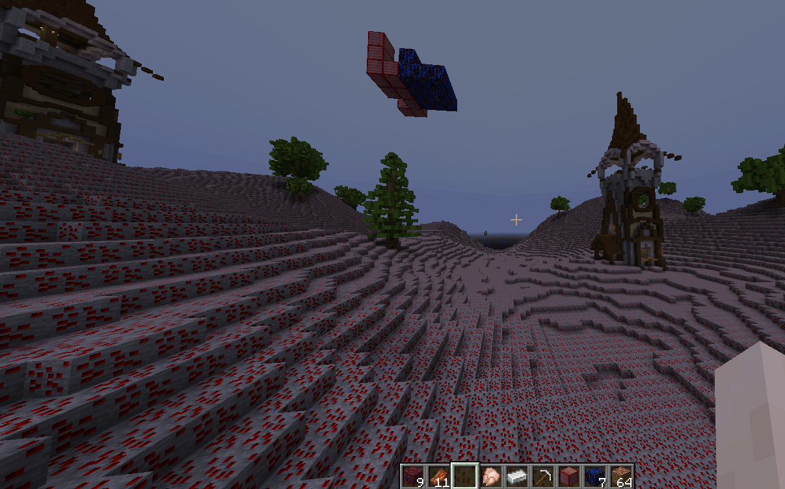

# RealisticWorldGenerator

## [此处下载](https://www.spigotmc.org/resources/realisticworldgenerator-1-8-8-1-16-x.15905/)

## 兼容性

* 生物群系
* 矿物
* 蓝图 (RWG 蓝图)

## 警告

不要将自定义方块作为基础矿石方块，否则会造成严重卡顿。\
请使用原版方块。

```yaml
ores:
  veins:
    biome_layers:
      paste: false
    type: 1
    enabled: true
  base:
    block: ia:itemsadder:ruby_block # <---- DO NOT DO THIS!
```

自定义方块仅用于：

* 地表
* 矿物
* 结构 (蓝图)

## 如何使用自定义方块

让我们创建一个以 ruby\_block 作为地表的生物群系作为例子。

打开 **RealisticWorldGenerator** 世界配置文件夹中的 `biomes.yml`。

确定一个群系（如 `plains`）并将下方内容作为首层。

```yaml
plains:
  layer:
    '1':
    - ia:itemsadder:ruby_ore;120
    '2':
    - minecraft:coarse_dirt;2
    - minecraft:podzol[snowy=false];5
    - minecraft:grass_block[snowy=false];100
```

此例中我也修改了该世界的 `settings.yml` 文件来确保只生成一种群系，以更快找到自定义方块。

```yaml
one_biome:
  biome: PLAINS
  oceans: false
  enabled: true
```

### 最终结果

这是一个带有自定义地表的世界




