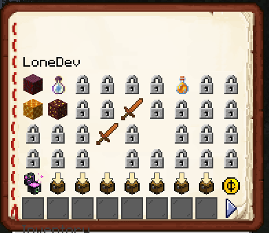

# RPGBank

## [此处下载](https://www.spigotmc.org/resources/%E2%9C%85must-have%E2%9C%85-rpgbank-store-your-items-exp-and-money-using-villagers-npcs-and-custom-gui.29139/)

你必须安装 [DefaultPack](../../plugin-usage/first-install.md)！

你可以使用 ItemsAdder 图标来改变 GUI图标：



```yaml
  icons:
    money-indicator: coin
    next-page: icon_right_blue
    previous-page: icon_left_blue
    page-indicator: BLACK_STAINED_GLASS_PANE
    deposit-exp: icon_ender_chest
    locked: icon_lock
    deposit-money: icon_arrow_chest
```

```yaml
account-title: :offset_-16::blank_menu::offset_-176:&0{player}
```

