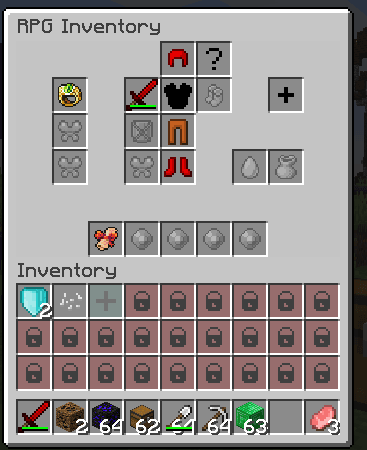

# RPGInventory

* 安装[官方附属](https://www.spigotmc.org/resources/addon-rpginventory-compatibility-for-itemsadder.84701/)
* 安装 [RPGInventory-BetterConfigs](https://www.spigotmc.org/resources/rpginventory-betterconfigs.85230/)

由于 RPGInventory 最近的更新，可能无法正常生效。\
RPGInventory 已经几乎被开发者放弃，我什么都做不了。
