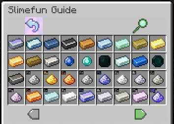

# Slimefun4

## [此处下载](https://github.com/Slimefun/Slimefun4#download-slimefun-4)

## 如何安装粘液科技资源包

不需要Optifine！

注意：这并非官方资源包，我也不是资源包作者。请勿向我寻求帮助，谢谢。

* [下载资源包](https://www.planetminecraft.com/texture-pack/slimefun-texture-by-raulh22/)
* 复制 [items-model.yml](https://www.mediafire.com/file/4s42i4b1uk6r05j/file) 到Slimefun文件夹内
* 将 Slimefun 资源包与 ItemsAdder 资源包合并（[参阅此处](../../adding-content/merge-resourcepacks.md)）
* 完成

