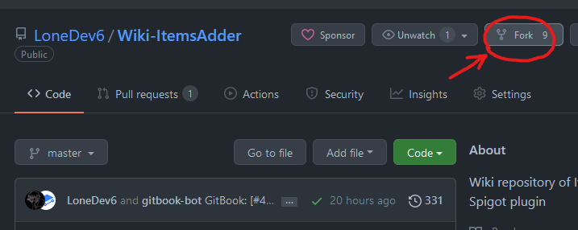
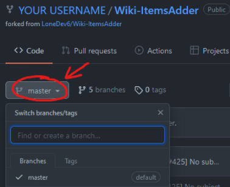
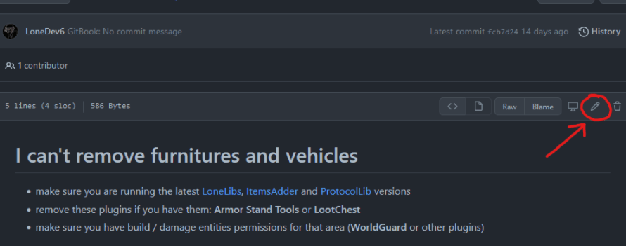
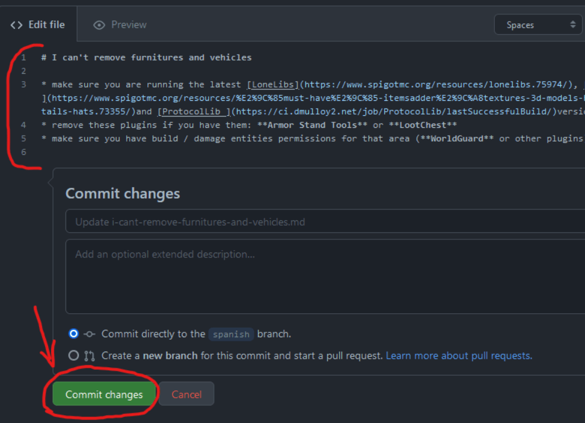
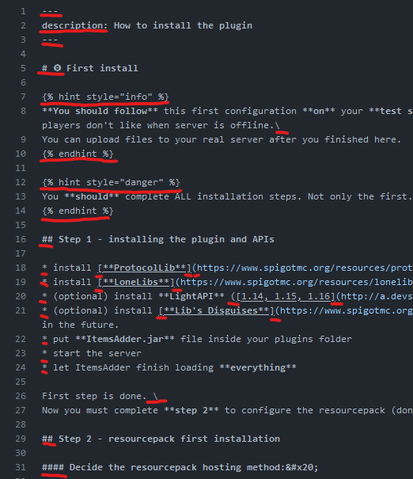
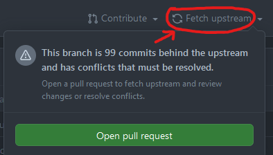
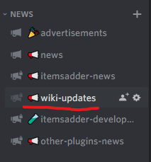

# 编辑英文 wiki

## 如何编辑此 wiki？

### 设置仓库

打开此 Wiki 的 [**GitHub 仓库**](https://github.com/LoneDev6/Wiki-ItemsAdder)，点击 **Fork** 创建自己的副本。

确认基础分支为 `master`。保持 fork 的 `master` 分支与原仓库同步，并为每次贡献创建名称明确的独立分支。

选择你想编辑的文件并点击 **铅笔** 按钮

编辑文件，使用 **Preview** 选项卡检查 Markdown 的渲染效果后再继续。然后点击 <mark style="color:green;">**Commit changes**</mark>，输入简短的更改说明，并选择为此次提交创建新分支的选项。

#### 重要提示

* 不要删除特殊字符 `#`，只编辑其后的标题文字。
* 不要删除或编辑 `{ }` 内的特殊文本，例如 ``，这些用于创建提示消息框。
* 不要删除 `*` 字符，这些用于创建列表。
* 不要删除表情符号。
* 不要编辑或删除部分页面顶部的 `--- description: ---`，只编辑其中的文字。
* 不要删除某些行末的 `\`。
* 保留已有链接、图片路径和 GitBook 指令，除非它们本身就是需要修正的内容。
* 不要重命名或移动文件，除非本次改动明确需要这样做，否则可能破坏其他页面的引用。

### _<mark style="color:red;">不可</mark>_编辑的内容示例

### 发起 pull request

提交更改后，从自己的分支向 `LoneDev6/Wiki-ItemsAdder` 的 `master` 分支发起 pull request。使用明确的标题，说明改动内容及原因；提交前再次检查更改文件。

GitHub 当前的具体步骤见[从 fork 创建 pull request](https://docs.github.com/en/pull-requests/how-tos/create-pull-requests/creating-a-pull-request-from-a-fork)。维护者会在 pull request 中审阅贡献；需要帮助时仍可使用 Discord，但提交编辑不要求联系 Discord。

如果按钮或文字与截图不同，也可以参阅 [GitHub 文件编辑指南](https://docs.github.com/en/repositories/working-with-files/managing-files/editing-files)。

### 保持 fork 同步

开始新的贡献前，先更新你的 fork，使其包含英文 Wiki 的最新更改。

在 fork 页面点击 **Sync fork**，再点击 **Update branch**。下方旧截图使用的是以前的 **Fetch upstream** 文字；当前操作方法见 [GitHub 的 fork 同步指南](https://docs.github.com/en/pull-requests/collaborating-with-pull-requests/working-with-forks/syncing-a-fork)。

\
也可以在 Discord 通知频道跟进变更。

