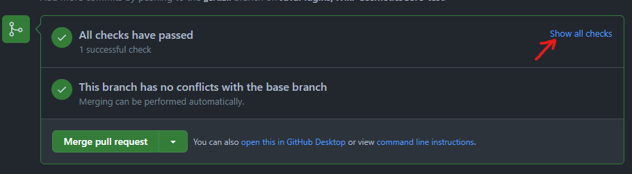
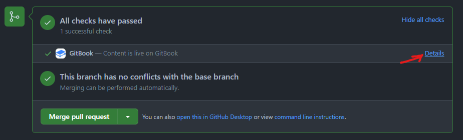

# 预览更改

每个 pull request 都会运行自动 GitBook 检查。等 GitHub 显示 **All checks have passed** 后，点击 **Show all checks**。

<figure><figcaption>展开 pull request 的检查区域。</figcaption></figure>

找到 **GitBook** 检查并点击 **Details**。GitBook 会打开基于你的分支构建的预览，可以在维护者合并 pull request 前检查编辑后的页面。

<figure><figcaption>打开 GitBook 检查，查看生成的预览。</figcaption></figure>

分别在桌面和移动端宽度下检查标题、代码块、提示、链接和图片。如发现问题，将修正提交到同一分支，pull request 和预览会自动更新。
