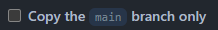
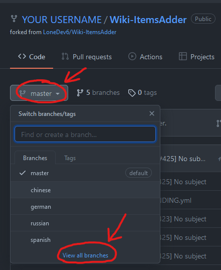
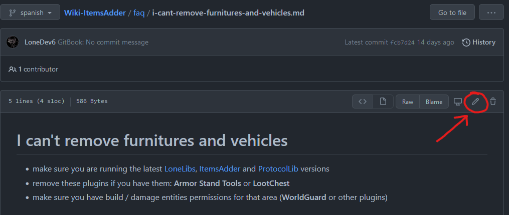
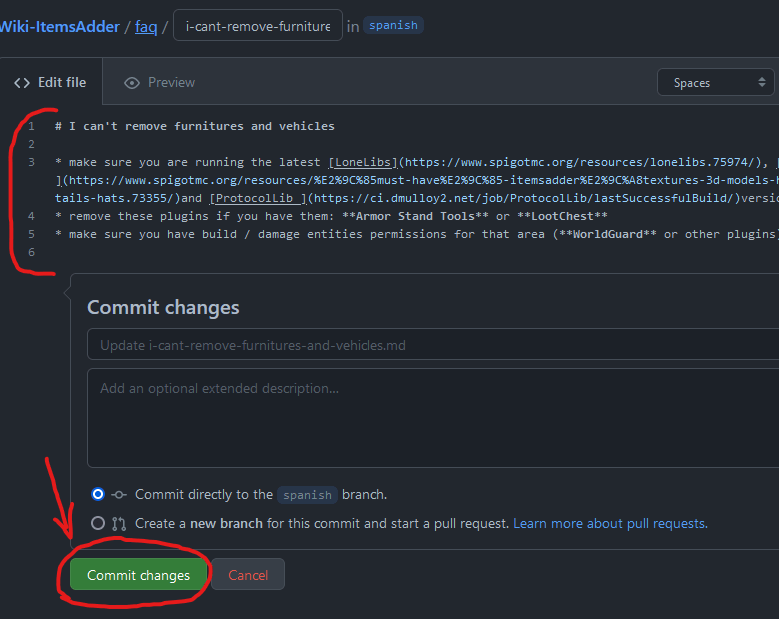

# 翻译此 wiki

## 如何翻译此 wiki？

### 为您的语言获取一个新分支

联系 LoneDev 并请求他为您的语言创建一个**新分支**。\
可以在 Discord 上联系 **LoneDev** 或在社区频道中打开支持工单。

### 设置仓库

然后，在分支创建后，打开此 wiki 的 [**Github** 仓库](https://github.com/LoneDev6/Wiki-ItemsAdder)，点击 **`Fork`**。

取消勾选此选项！

<figure><figcaption></figcaption></figure>

点击这里更改分支。

不要编辑 `master` 分支！

选择您想编辑的文件并点击 **铅笔** 按钮

编辑文件然后点击 <mark style="color:green;">**提交更改**</mark>

#### 重要提示

* 不要添加内容或新页面，只翻译文本。
* 您可以添加的唯一内容是在欢迎页面中的“翻译者”文本。
* 不要删除 `#` 特殊字符，只翻译后面的文本，这些是标题。
* 不要删除或编辑 `{ }` 内的特殊文本，例如 ``，这些用于创建提示消息框。
* 不要删除 `*` 字符，这些用于创建列表。
* 不要删除表情符号。
* 不要翻译或删除某些页面顶部的 `--- description: ---` 文本，只翻译内部文本。
* 不要删除某些行末的 `\`。
* 不要删除 `[TEXT](LINK)` 部分，只翻译文字，这是可点击的链接。

### _<mark style="color:red;">不可</mark>_编辑的内容示例

### 最后一步

联系 **LoneDev** 以便审核并将您的更改添加到维基中。\
可以在 Discord 上联系 **LoneDev** 或在社区频道中打开支持工单。

最好在主仓库（英文版）每次编辑时更新您的翻译，以反映更改。\
也可以在 Discord 通知频道跟进变更。

