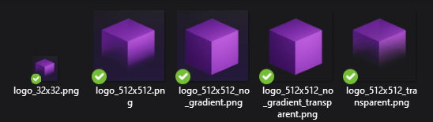
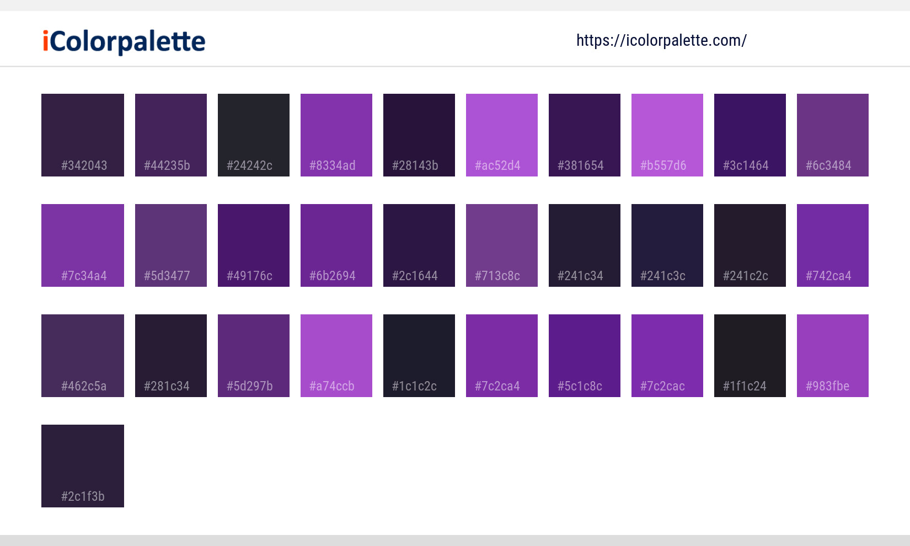

# ItemsAdder 标识

## 下载 ItemsAdder 标识资源

以下 ZIP 文件包含您可以用于资源页面或与 ItemsAdder 相关的资源。\
开始前，请先阅读[使用条款](branding.md#usage-terms)。

### ZIP 内容预览

## 使用条款 

您**可以**在以下情况下使用这些资源：

* 在您拥有的支持 ItemsAdder 的插件和/或附加组件的资源页面上。
* 在您资源的自定义图片中。

...但需遵守以下条件：

* 您不得声称拥有这些资源的所有权。原始所有权归 ItemsAdder 的开发者 LoneDev 所有。
* 您不得声称自己创建了这些资源。
* 您不得使用这些资源或其部分来创建您自己的资源标志。
* 您不得重新分发这些资源。这包括但不限于修改后的 ZIP 文件和实际文件本身。
* 通过链接到原始品牌页面（本页）来注明来源。
* 这些图片只能用于引用 ItemsAdder。

## 致谢

* 感谢 Andre\_601 创建 `ia_addon_banner` 文件
