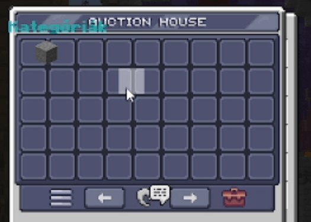

# 1.21.5+ 移除物品栏槽位高亮

这会移除整个游戏中**所有**槽位的高亮效果。

由于 Minecraft 1.21.5+ 中的硬编码限制，此修复会移除游戏中**所有**物品栏的悬停高亮效果，而不仅是自定义菜单。ItemsAdder 没有办法绕过或修复此行为。

<figure><figcaption></figcaption></figure>

### 步骤 1

下载修复文件，并解压到 ItemsAdder 文件夹中。

### 步骤 2

使用 `/iazip` 重新生成资源包。如有需要，重新上传资源包，请参阅托管教程。

由于这会移除_任何_物品栏的高亮效果，因此并不一定适合所有服务器。\
目前，我没有更好的解决办法，也可能找不到其他办法。
