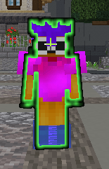

# 盔甲发光轮廓问题

## 玩家穿戴盔甲时发光轮廓异常

<figure><figcaption></figcaption></figure>

### 这是一个已知问题

此问题没有修复办法，可能是自定义盔甲实现方式的限制。\
不过，这只是一个轻微的显示问题，我认为服务器上的玩家应该不会受到太大影响。

要修复此问题，必须在 `config.yml` 中禁用自定义盔甲着色器。如果你未使用这些自定义盔甲，就可以这样做。
