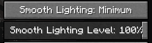

# 动画和发光效果不起作用

如果客户端使用以下内容，动画和发光效果将不会显示：

* [**Fabulously Optimized**](https://www.curseforge.com/minecraft/modpacks/fabulously-optimized) 整合包
* 用于替换 **Optifine** 的模组

## 动态盔甲和发光效果不起作用

### 在 Fabulously Optimized 上

这是 **Fabulously Optimized** 整合包的限制。\
阅读更多内容：[https://github.com/SHsuperCM/CITResewn/issues/87](https://github.com/SHsuperCM/CITResewn/issues/87)

### 在 Optifine 或原版上

启用平滑光照以修复发光效果

