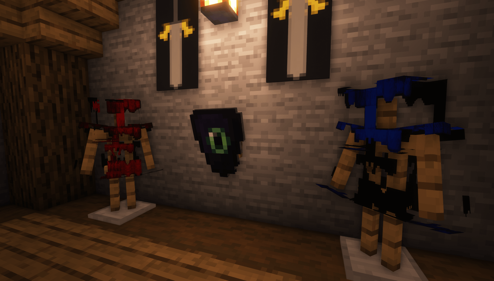
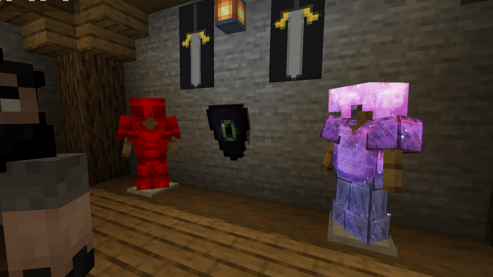

# 盔甲纹理与光影模组不兼容

如果服务器和客户端均为 1.21.2 或更高版本，你可以使用新的盔甲创建方法。它不使用任何原版着色器来创建自定义盔甲，因此兼容光影模组。

更多信息见[此处](../../adding-content/items/armors.md)。

## 这个问题的原因是什么？

### Optifine 问题

Optifine 有一个限制，如果你安装了任何自定义 Optifine 光影，自定义盔甲将无法正常工作。

你必须暂时禁用 **Optifine** 光影或暂时忍受这个问题。

我已经联系了 Optifine 开发者：[https://github.com/sp614x/optifine/issues/6391](https://github.com/sp614x/optifine/issues/6391)

### Iris Shaders 问题

Iris 有一个限制，如果你安装了任何自定义 Iris 光影，自定义盔甲将无法正常工作。

我已经联系了 Iris 开发者：[https://github.com/IrisShaders/Iris/issues/1042](https://github.com/IrisShaders/Iris/issues/1042)
