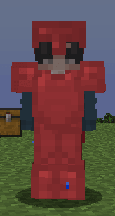

# 皮革盔甲纹理有金属质感

## 皮革层不断被 ItemsAdder 覆盖



ItemsAdder 会自动覆盖皮革层纹理以创建自定义盔甲。\
自定义盔甲是使用彩色皮革创建的，但默认的 Minecraft 皮革盔甲纹理看起来不像矿物质纹理。

在某些服务器中，您可能根本不需要此功能，并且您可能更喜欢使用原版的皮革盔甲层纹理，或者使用您自己的自定义纹理。

## 如何禁用此功能？

要禁用此功能，只需在 ItemsAdder 的 config.yml 中设置此选项，并再次运行 `/iazip`（然后按需[托管资源包](../../plugin-usage/plugin-configuration/resourcepack-hosting.md)）。

```yaml
custom_armors_shaders_legacy:
  vanilla:
    overwrite_leather_layers: false
```

```yaml
overwrite_leather_armor_layers_textures: false
```

```yaml
disable-overwrite-leather-armor-layers-textures: true # Set it to true not FALSE!
```
