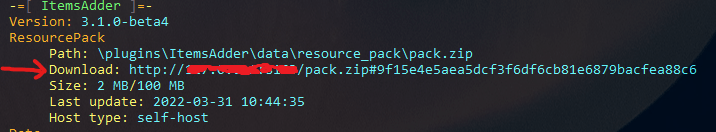

# 在 BungeeCord 和 Velocity 上使用单个资源包

在每个服务器的 `resource-pack.hosting` 部分中，仅启用一个托管服务。构建并托管资源包的服务器使用选定的服务；其他服务器使用 `external-host`，并填写同一个资源包 URL。

## 全群组服通用的资源包

你是否想在群组服的多个 Spigot 服务器上安装 ItemsAdder？\
你是否想避免玩家每次切换服务器时都下载资源包？\
按照这个简单的教程操作。

## 设置方法

例如，你有 3 个服务器：`lobby`、`survival`、`creative`。\\

### 步骤 1

在这 3 个服务器上都安装 ItemsAdder。

<mark style="color:red;">**这非常重要**</mark>

每次更改物品、纹理、模型、声音或其他资源包内容时，都要在三个服务器上同步 `plugins/ItemsAdder/contents/`。内容配置必须保持一致；源服务器和其他服务器之间只有 `config.yml` 托管部分不同。

这一步至关重要，否则整个设置都无法正常工作。

### 步骤 2

选定一个主服务器，例如 `lobby`。\
打开 `lobby` 服务器上 ItemsAdder 的 `config.yml`，配置托管。

[资源包托管](../../plugin-usage/plugin-configuration/resourcepack-hosting.md)

对于 ItemsAdder 4.0.17+，`simple_self_host` 是最简单的选项，因为它无需手动设置端口转发。如果你需要自行控制公网地址和端口，现有的 `self-host` 方法仍然适用。

```yaml
resource-pack:
  hosting:
    no-host:
      enabled: false
    simple_self_host:
      enabled: true
      server_address: auto
    lobfile:
      enabled: false
    external-host:
      enabled: false
      url: ''
    self-host:
      enabled: false
      server-ip: 127.0.0.1
      pack-port: 8163
```

在此源服务器上运行 `/iazip`，生成并托管资源包。

配置完托管后（仔细按照链接中的教程操作），使用 `/iainfo` 命令，在控制台中找到 URL 并复制。

例如：



使用资源包的直链。如果显示的文本在 `#` 后包含片段，请勿将该片段包含在 `external-host.url` 中。

#### 例如使用 `self-host`：

<details>

<summary>自行托管示例</summary>

<p class="code-title"><code>config.yml</code></p>

```yaml
resource-pack:
  hosting:
    no-host:
      enabled: false
    simple_self_host:
      enabled: false
      server_address: auto
    lobfile:
      enabled: false
    self-host:
      enabled: true
      server-ip: YOUR_SERVER_IP_HERE
      pack-port: 8163
    external-host:
      enabled: false
      url: ''
```


运行 `/iazip` 生成资源包。

</details>

### 步骤 3

打开其他服务器（survival、creative）的 ItemsAdder `config.yml` 文件并编辑托管部分。\
在 `YOUR_PACK_COMPLETE_URL` 处填写你从 `/iainfo` 命令中获得的 **URL**。

```yaml
resource-pack:
  hosting:
    no-host:
      enabled: false
    simple_self_host:
      enabled: false
      server_address: auto
    lobfile:
      enabled: false
    self-host:
      enabled: false
      server-ip: 127.0.0.1
      pack-port: 8163
    external-host:
      enabled: true
      url: 'YOUR_PACK_COMPLETE_URL'
```

更改 URL 后，在其他服务器上重载 ItemsAdder。还可以在浏览器中打开 URL 进行检查：它必须直接下载生成的 `.zip` 文件。

### 步骤 4（仅 Bungeecord）

安装 Bungeecord 插件，使加载速度更快！


<mark style="color:red;">**不要安装**</mark> <mark style="color:red;">**BungeePackFix**</mark> <mark style="color:red;">**到**</mark> <mark style="color:red;">**Spigot**</mark> <mark style="color:red;">**服务器上！**</mark>

这是一个 **Bungeecord** 插件！请安装在 **Bungeecord** 上！
