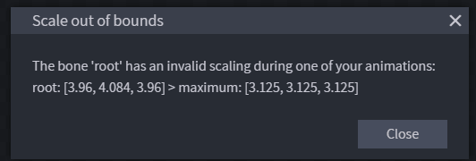
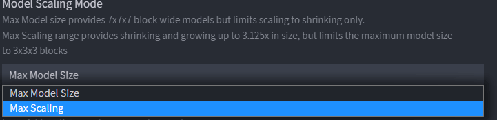

# Blockbench 错误

## 异常错误

有时你可能会遇到未知错误。

由于 ItemsAdder 工具仍处于测试阶段，为避免这些问题，应避免同时在 Blockbench 中打开多个自定义项目。未来会处理此问题。

## “Scale out of bounds”错误

要修复此问题，打开 **ItemsAdder Entity** 设置，并设置 [Max Scaling](../adding-content/entities/advanced-method.md#configuring-the-model)。

