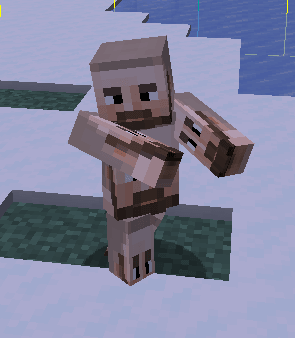
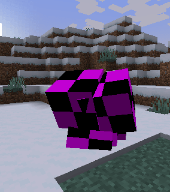
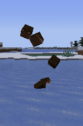
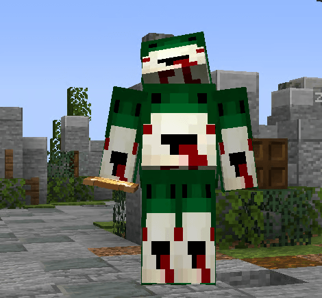
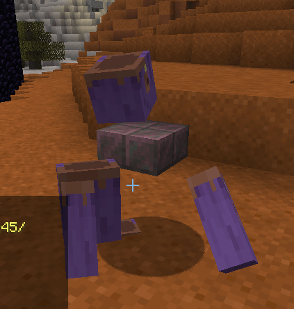
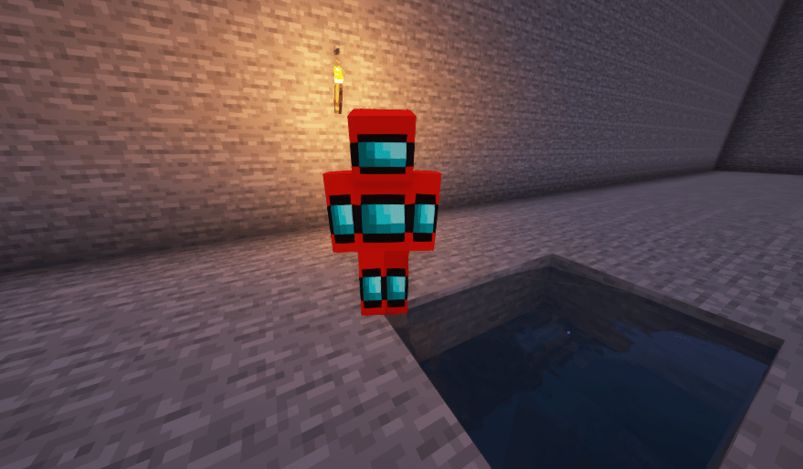
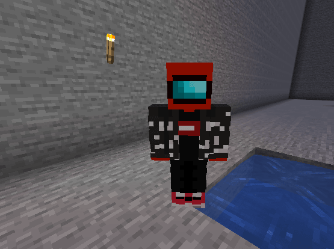

# 表情动作问题

确保已接受资源包，并在 ItemsAdder 的 `config.yml` 中启用了表情动作。也可以尝试使用 `/iazip` 重新生成资源包。

## 情况 1

<figure><figcaption></figcaption></figure>

```yaml
emotes:
  1_21_5_to_1_21_9_shaders: true
```

如果使用 _1.21.9_ 或更新的客户端加入，并启用了 `1_21_5_to_1_21_9_shaders`，表情动作会渲染异常，玩家头部可能被拉伸。这是因为 `1_21_5_to_1_21_9_shaders` 仅支持 _1.21.5_ 至 _1.21.9_ 版本。

如果需要支持 1.21.4 及更新的客户端，必须改用 `1_21_4_plus_modern_method`（并重新生成资源包）。

## 情况 2

<div><figure><figcaption></figcaption></figure> <figure><figcaption></figcaption></figure></div>

如果客户端为 _1.21.3_ 或更旧版本，则无法使用 `1_21_4_plus_modern_method`，必须继续使用 `1_21_5_plus_emotes_shaders`。

## 情况 3

<div><figure><figcaption></figcaption></figure></div>

如果使用 `1_21_5_plus_emotes_shaders` 或 `legacy_shaders`，可能有插件或其他资源包覆盖了着色器（仅 _1.21.8_ 及更旧的客户端会出现此问题）。

检查合并资源包文件夹中的文件：

```yaml
merge_other_plugins_resourcepacks_folders:
- ModelEngine/resource pack
```

同时检查 `ItemsAdder/contents` 文件夹中是否有可能产生干扰的着色器。

## 情况 4

Minecraft 26.1

<div><figure><figcaption></figcaption></figure></div>

确保使用 `1_21_4_plus_modern_method: true` 并重新生成资源包，因为 Minecraft _**26.1**_ 已不再支持 `1_21_5_to_1_21_9_shaders` 和 `legacy_shaders`。\
（更改后重新生成资源包）。

## 模组问题（仅与原版着色器方法有关）

如果使用 `1_21_5_plus_emotes_shaders` 或 `legacy_shaders`，使用光影模组时就会出现此问题（仅 _1.21.8_ 及更旧的客户端会出现此问题）。

允许使用自定义光影的模组会破坏表情动作，因为它们会覆盖/替换 ItemsAdder 表情动作功能使用的原版着色器。

唯一的_“修复”_办法是禁用光影本身，或移除相应的光影模组。





### 已知会导致问题的光影模组

* Optifine: [https://github.com/sp614x/optifine/issues/6391](https://github.com/sp614x/optifine/issues/6391)
* IrisShaders: [https://github.com/IrisShaders/Iris/issues/1042](https://github.com/IrisShaders/Iris/issues/1042)
* 更改玩家皮肤的模组：
  * 模组可能会更改默认的玩家模型/皮肤，因此会受到 ItemsAdder 着色器修改的影响，反过来也一样。
* 3DSkinLayers
  * 此模组会修改皮肤的外层，使其呈现 3D 效果，从而改变玩家模型本身。\
    一种可能的修复办法是在模组设置中禁用 3D Skulls 和 3D Skull Items。\
    目前没有在表情动画中使用 3D 皮肤层的变通方法。\
    更多信息请参阅[相关问题](https://github.com/tr7zw/3d-Skin-Layers/issues/45)。
* Customizable Player Models
  * 这类模组允许完全自定义玩家模型，包括替换模型的部分或整体。\
    因此，ItemsAdder 的表情动作会显示异常，目前除了不使用该模组或不使用表情动画之外，没有其他修复办法。
